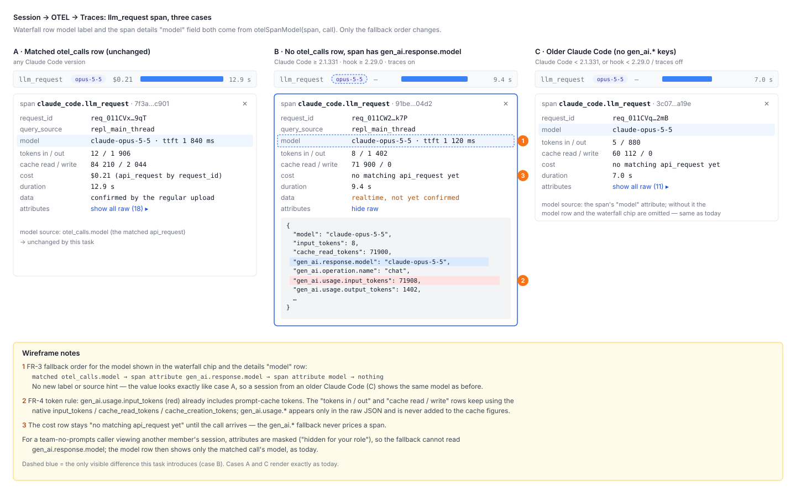

# 2026-11-24: Claude Code OTEL Events Triage

**Status:** todo
**Priority:** medium
**Type:** feature
**Module(s):** server | client | hook
**Owner:** denis.tsyplakov
**Created:** 2026-11-24
**Tracker:** GH-170 https://github.com/DataArt/artisyn-log-hub/issues/170

## Description

Raw idea (from the morning check 2026-11-24, `docs/morning-check/daily/2026-11-24-1438.md`):

Triage Claude Code OTEL events and attributes that Log Hub does not track yet. Log Hub's OTEL tabs
read only `claude_code.api_request` logs (cost, `otel_calls`) and spans (`claude_code.interaction`
/ `llm_request` / `tool`); every other log event arrives in the raw claude-otel chunks but is not
projected or shown ([otel-tabs.md](../../../knowledgebase/otel-tabs.md): `api_error` /
`user_prompt` are not stored in any table; Code Mode note in the compatibility matrix).

Untracked documented events (grep of `server/src`, `client/src`, `hook` found no reference):
`compaction`, `api_retries_exhausted`, `api_refusal`, `skill_activated`, `subagent_completed`,
`hook_registered`, `hook_execution_start`, `hook_execution_complete` (now with output size
counts), `hook_plugin_metrics`, `permission_mode_changed`, `plugin_installed`, `internal_error`,
`at_mention`, `feedback_survey`, `managed_settings_resolved`, `retention_sweep`.

Carrier events of the untracked attributes below, also not projected: `tool_decision`,
`user_prompt`, `api_error`, and `tool_result` if Log Hub does not read it either.

Untracked attributes:

| Claude Code | Item |
|---|---|
| 2.1.301 | `tool_decision`: `classifier_verdict`, `classifier_category`, `permission_mode` |
| 2.1.325 | `user_prompt`: `delivery.mode: "mid_turn"` for messages sent mid-turn |
| 2.1.331 | `claude_code.llm_request` span: `gen_ai.response.model`, `gen_ai.operation.name`, `gen_ai.usage.*` |

Already handled, out of scope: `anthropic.plan` / `seat_type` / `provider` / `custom_base_url`
(2.1.317), the 5-minute / 1-hour cache-write split.

Important semantic trap: `gen_ai.usage.input_tokens` (semconv) **includes** prompt-cache tokens,
while the native `input_tokens` excludes them. Today Log Hub stores these attributes in
`otel_spans.attributes` and never reads them, so nothing is double-counted.

Sources: https://code.claude.com/docs/en/monitoring-usage, the Claude Code CHANGELOG.

## Functional Requirements

- **FR-1 Inventory.** Capture OTEL output of a real session on the current Claude Code through
  Log Hub's own hook upload (a hook-installed repo, installer OTEL env, tracing on) and list which
  of the events / attributes above actually arrive, with their attribute keys and sample values.
  The documented `gen_ai.usage.*` sub-keys are not settled yet, so check them on a real span.
  Per item the inventory records: the trigger used, the result — *arrived* / *triggered, not
  emitted* / *not triggered* (docs-only decision, with the reason) — and any env flag beyond the
  installer's set it needs. Reproduce deliberately every event with a cheap local trigger
  (`/compact`, a mode switch, a skill, a sub-agent, an `@`-mention, a plugin install, hooks, a
  mid-turn prompt, a tool permission decision); the rest (`api_refusal`, `api_retries_exhausted`,
  `internal_error`, `feedback_survey`, `managed_settings_resolved`, `retention_sweep`) may stay
  *not triggered*. For `hook_execution_*` / `hook_plugin_metrics` record the attribute that
  identifies the hook.
- **FR-2 Decision per item.** For every event / attribute record a decision: *surface* (name the
  place: session OTEL tab, Live view, session cost diagnosis / antipatterns, hook overhead view),
  *store only*, or *ignore*, with a one-line reason. Each row names the existing Log Hub source
  for the same fact, if any (compaction → `session_cause_stats` / `CacheRatioCauses.compaction`;
  `skill_activated` → `otel_calls.skill_name`; `subagent_completed` → `agent_id` on calls and
  spans plus the transcript), and says whether the event replaces it, complements it (with the
  join key) or is a duplicate. Surfacing an attribute means projecting its carrier event.
  Candidates with likely product value: `compaction`, `api_retries_exhausted` / `api_refusal`,
  `skill_activated`, `hook_execution_*` (including our own hook's overhead), `subagent_completed`,
  `delivery.mode`, `classifier_verdict`. The decisions go to the owner for approval
  (`open_questions_ru.md`) before FR-5 starts.
- **FR-3 Model fallback.** `otelSpanModel`
  (`client/src/viewer/pages/repository/session-log/otel/otel-span-format.ts`) uses
  `gen_ai.response.model` as a fallback after the matched call's model and before the `model`
  attribute.
- **FR-4 Token rule in the KB.** `docs/knowledgebase/otel-tabs.md` (span attributes) and
  `docs/knowledgebase/llm-call-math.md` say that `gen_ai.usage.input_tokens` already includes
  cache tokens and must never be added to `cache_read_tokens` / `cache_creation_tokens` again.
- **FR-5 Implement the "surface" decisions** that FR-2 selects (may be split into follow-up tasks
  if large). Surfaced events reach the client as a new optional field on the existing session
  OTEL facts response, included in the `since` / `seq` deltas, with its row in
  `server/test/contract/registry/`; event attributes are dropped for `team-no-prompts` callers
  under the DD-22 masking rule. The hook overhead view marks Log Hub's own hook by the attribute
  FR-1 found and groups every other hook under "Other hooks".
- **FR-6 Compatibility.** Old Claude Code versions (which don't send these) and old hooks keep
  working; the compatibility matrix in `otel-tabs.md` gets a row per new item. A span-attribute
  row lists all three conditions — Claude Code ≥ 2.1.331, hook ≥ 2.29.0, tracing on — and the
  behaviour when any is missing.

## Acceptance Criteria

- [ ] FR-1: the task folder holds an inventory table (event / attribute · trigger used · result
      arrived / triggered-not-emitted / not-triggered · CC version checked · extra env flag ·
      sample attributes), built from a real capture, not from docs alone.
- [ ] FR-2: every item in the Description has a decision, a reason and its existing Log Hub
      source (or "none"); "surface" items name the UI place; the owner approved the list.
- [ ] FR-3: a span without a matching `otel_calls` row but with `gen_ai.response.model` shows that
      model; a span from an older Claude Code, an old hook or with masked attributes shows the
      same model as before.
- [ ] FR-4: both KB articles state the `gen_ai.usage.input_tokens` rule.
- [ ] FR-5: each surfaced item is visible in the named place and covered by a step in an existing
      scenario (`tests/scenarios/`, e.g. `s-otel-01`); a projected ("store only" or "surface")
      item is filled after re-projection for sessions uploaded before the change.
- [ ] FR-6: the compatibility matrix lists the new items; `s-compat-01` (frozen old hook) still
      passes.

## Common sense considerations

- The FR-1 capture goes through Log Hub's own hook upload, since that is the data the product sees.
- Event results are three-valued (arrived / triggered, not emitted / not triggered), so an untriggered event is never read as "not emitted".
- Carrier events `tool_decision`, `user_prompt`, `api_error`, `tool_result` get their own inventory rows; surfacing an attribute projects its carrier.
- FR-2 decisions are approved by the owner before FR-5 starts.
- Each FR-2 row names the existing source of the same fact, to avoid two conflicting numbers in the UI.
- Surfaced events extend the existing session OTEL facts response with an optional field (old clients ignore it); new routes only if a plan proves the field unworkable.
- DD-22 masking applies to event attributes as it does to span attributes.
- Any projected item is backfilled through the `OTEL_PROJECTION_VERSION` bump and checked for pre-change sessions.
- Span-attribute compatibility rows list CC version, hook ≥ 2.29.0 and tracing; when any is missing the model fallback behaves as today.
- Log Hub's own hook is identified by the attribute FR-1 records; unmatched hooks are grouped as "Other hooks", never dropped.

## Open Questions

- What does the FR-2 "store only" decision mean, given that the raw claude-otel chunks (and `otel_spans.attributes`) already keep every event and attribute? (a) Nothing new — rename it "ignore (kept in raw chunks)" and keep only surface / ignore; or (b) projection by `applyOtelLines` into a queryable table, e.g. one generic `otel_events` table (migration, `OTEL_PROJECTION_VERSION` bump to 3, rows in `docs/algorithm-examples/otel-facts.json`, `db-state-update`, same retention as the other OTEL fact tables) — and if (b), is it implemented in this task or only recorded?
- Which "surface" items does this task implement and which become follow-up tasks? Options: items that need a new table, migration or route become follow-ups (scratched, with a GH issue) and items that read already-projected data stay here; or "at most the N highest-value items" chosen in FR-2. Should the FR-5 acceptance criterion then require every "surface" item to be either implemented or linked to a scratched follow-up task id?

## Notes

<!-- Append timestamped notes here as work progresses -->
