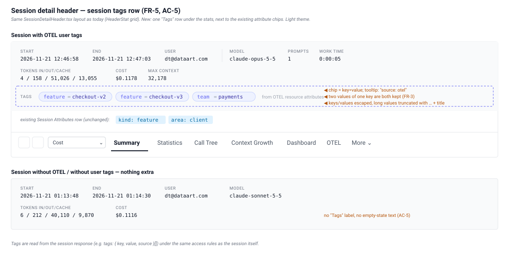
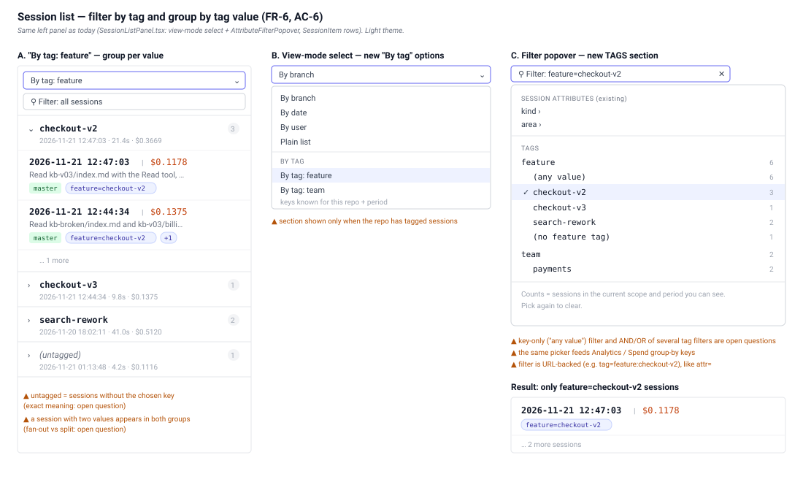
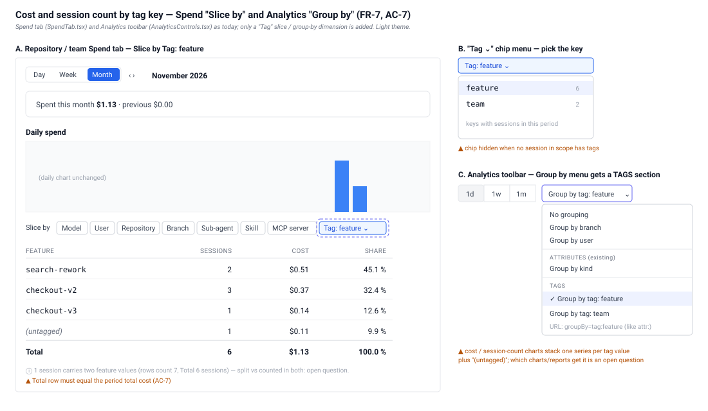

# 2026-11-24: Session Tags from OTEL Resource Attributes

**Status:** todo
**Priority:** medium
**Type:** feature
**Module(s):** server | client | hook | installer
**Owner:** denis.tsyplakov
**Created:** 2026-11-24
**Tracker:** GH-174 https://github.com/DataArt/artisyn-log-hub/issues/174

## Description

A user can add custom attributes to `OTEL_RESOURCE_ATTRIBUTES` (e.g. a feature slug:
`feature=checkout-v2`) next to Log Hub's own `artisyn.repo` tag. Log Hub should pick these
attributes up as **session tags**, show them on the session and let the user filter/group sessions
and cost by them (e.g. how many sessions and how much money each feature took).

Tags are a **universal feature**: a generic session-tag model (key, value, source) that other
sources plug into later. This task delivers the model plus its first source — OTEL resource
attributes.

**This is a rework of the existing session "context" feature, not a parallel one.** Log Hub
already has key=value session context: the hook config's `context` array
(`.artisyn/config/log-hub.json` → `"context": [{key, value}]`, legacy `CTX_*` variables) is
attached to `prompt_start`, stored in `contexts` / `log_contexts` and shown in the repository
header. OTEL resource attributes are now the standard way to label sessions, so the feature keeps
its purpose and its display but takes its values from OTEL instead of the hook config, and is
brought up to date (it has not been touched for months — see the gaps below). The hook-config
source is removed. Session Attributes (the LLM-extracted, team-defined values) are a different
feature and are **not** touched.

### Current state (2026-11-24)

- The installer writes `OTEL_RESOURCE_ATTRIBUTES` into the repo's `.claude/settings.local.json` as
  user-scope value + existing local value + `artisyn.repo=<repoKey>` (`buildResourceAttributes`,
  `artisyn-hooks-installer/src/otel-env.ts:81`; KB `hook-installation.md` §"OTEL_RESOURCE_ATTRIBUTES
  in the mirror"). A user can already add `feature=<slug>` there by hand and it survives a reinstall.
- The receiver (`hook/.claude/telemetry_tool/otel-receiver.js:535`, `:578`, `:640`) flattens
  resource attributes into each line's `resource` field for logs, metrics and spans.
- The server stores each chunk verbatim in `logs_otel.body` (jsonb). From `resource` it reads only
  `service.version` (`server/src/logs/otel-chunk.ts:194`) and the `anthropic.*` account fields
  (`server/src/logs/otel/otel-records.ts:347`). The client never reads `resource`.
- Existing session context (the feature this task reworks):
  - hook: `context` key in `CONFIG_DEFAULTS` / `CONFIG_TYPES` and `getEnvContext()`
    (`hook/.claude/telemetry_tool/env-context.js:95`, `:587`); `telemetry-hook.js:116` adds
    `context: {key: value}` to every `prompt_start` event;
  - installer: `.env` → `log-hub.json` conversion collapses `CTX_*` into `context`
    (`artisyn-hooks-installer/src/install.ts:453`); the config template carries `"context": []`;
  - server: `extractContextPairs()` (`server/src/logs/artisyn-extractor.ts:609`) and "Step 6 —
    Context upsert + link" in `logs.service.ts:1078` write tables `contexts` / `log_contexts` (new
    inserts only); routes `GET /api/v1/repositories/:repoId/contexts` and
    `GET /api/v1/repositories/:repoId/sessions/:sessionId/contexts`
    (`repositories.controller.ts:1346`, `:1385`); orphan-context cleanup on session delete
    (`sessions.service.ts:387`), team delete (`teams.service.ts:645`);
  - client: `fetchRepositoryContexts` (`api.ts:529`), `RepositoryContext` model,
    `repoContextsQuery` (`useRepositoryData.ts:134`) and the context chips in
    `RepositoryHeader.tsx:42`;
  - tests/docs: contract rows `F14-contexts*`, `F17-session-contexts*`, the `contexts` /
    `log_contexts` expectations in `f18-session-delete-retention.ts`, scenario steps that send or
    check contexts (`s-ingest-02` and others — grep `contexts`), KB `hook-installation.md`
    (`context` key, `CTX_*`), `server-endpoint-map.md`, `db-tables.md`, `db_state.sql`.
- Gaps in the existing context feature (to fix while reworking it):
  - the repository header lists every distinct pair the repository ever had — no period, branch
    or user scope, and `GET .../contexts` applies no team visible-users filter (the per-session
    route does), so a team view can show pairs from sessions the viewer cannot open;
  - the per-session route exists but the client never calls it: the session view shows no context;
  - pairs are written only on the first insert of a session's `artisyn` log and are linked to log
    rows, not to the root session, so subagent sessions and re-uploads are not covered;
  - no filter, no group-by, no cost breakdown; keys are lowercased by the hook.

## Functional Requirements

- FR-1: A generic session-tag model: a session has a set of tags, each `key`, `value`, `source`.
  It is not tied to OTEL — the same storage, API and UI serve any future source (e.g. a git branch
  → feature mapping). This task adds one source: `otel`. Tags live in their own table
  (`session_tags`, keyed on the root session id), separate from the typed, team-defined Session
  Attributes (`session_attribution`).
- FR-2: The server extracts user tags from the `resource` of a session's OTEL lines, inside
  `applyOtelLines` (`server/src/logs/otel/otel-facts-writer.ts`), so both the chunk and the realtime
  channel feed them, as an idempotent upsert on the root session id. A user tag is any resource
  attribute whose key does not start with a prefix on one server-side deny-list constant:
  `artisyn.`, `service.`, `telemetry.`, `host.`, `os.`, `process.`, `anthropic.`, `wsl.`, `user.`,
  `session.`, `organization.`, `terminal.`, `deployment.`, `k8s.`, `cloud.`, `container.`,
  `device.`, `faas.`, `aws.`, `gcp.`, `azure.`. Dotted keys outside the list (e.g. `team.name`) are
  user tags.
- FR-3: If the value of a key changes within one session, every distinct value is kept.
- FR-4: Already ingested `logs_otel` chunks are backfilled by bumping `OTEL_PROJECTION_VERSION`
  (2 → 3), so sessions recorded before this change also get their tags.
- FR-5: The session view shows the session's tags; subagent sessions show their root session's
  tags. Session row and session-detail responses carry `tags: { key, value, source }[]`. The
  repository header keeps its context chips, now fed by tags and limited to the current period,
  branch/user filters and the viewer's session access (the discovery query of FR-8).
- FR-6: The session list can be filtered by tag and grouped by the values of one chosen tag key.
  Filter parameter: repeatable `tag=<key>:<value>` or `tag=<key>` (any value); filters on
  different keys combine with AND, several values of one key with OR. Groups are the chosen key's
  values plus "untagged" = sessions without that key (they may have other tags).
- FR-7: Cost and session-count analytics can be broken down by a tag key (`groupBy=tag:<key>`,
  e.g. cost per `feature` value). Every Reports and Analytics screen offers a tag filter in its
  filter bar: the `tag=` filter and `groupBy=tag:` dimension are accepted on every route and screen
  that accepts `attr=` / `groupBy=attr:`; tag keys are not validated against team attribute
  definitions. A session with several values of the grouped key is counted in full in each of
  those groups (fan-out, like `groupBy=attr:`), and the fan-out caveat is shown.
- FR-8: A tag-discovery endpoint (modelled on `session-attribution/values`) returns the tag keys in
  the current scope and period, each with its values and session counts, under the session access
  rules; the filter and Group-by pickers list only these keys.
- FR-9: Switch the existing context feature from the hook config to OTEL tags:
  - hook: drop `context` from `CONFIG_DEFAULTS` / `CONFIG_TYPES`, `getEnvContext()` and the
    `context` field of `prompt_start`;
  - installer: stop writing `"context": []` into new configs; the `.env` conversion no longer
    collapses `CTX_*` into `context` — it prints one line saying `CTX_*` variables are no longer
    used and that labels now go into `OTEL_RESOURCE_ATTRIBUTES`;
  - server: `contexts` / `log_contexts` are replaced by `session_tags` (FR-1). A migration copies
    every existing pair into `session_tags` on the session's root with `source = config`, then
    drops the two tables — no data is lost. Ingest no longer projects `context` (drop
    `extractContextPairs()` and Step 6); the orphan-context cleanup becomes the `session_tags`
    cascade on session / team delete;
  - routes: `GET /api/v1/repositories/:repoId/contexts` and `.../sessions/:sessionId/contexts`
    stay with their `{ key, value }[]` shape, now read from `session_tags` (the repository route
    gains the scope and access rules of FR-5 / FR-8), so a client tab left open over an upgrade
    keeps working; the client moves to the FR-8 discovery endpoint and the `tags` field;
  - client: the repository-header chips stay (FR-5); the session view gains its tags (FR-5);
    the "context" wording in the UI becomes "tags";
  - tests/docs: update the contract rows `F14-contexts*`, `F17-session-contexts*`,
    `f18-session-delete-retention.ts` and the scenario steps that send `context` (an old-hook
    step keeps sending it to prove it is ignored), the KB articles listed above and the user docs
    / in-app help that mention `context` / `CTX_*`.

- FR-10: Log Hub warns about junk in tags instead of silently capping it. A tag key is **noisy**
  when one session carries more than 10 distinct values of it (a volatile value — commit SHA,
  timestamp, PID — put into `OTEL_RESOURCE_ATTRIBUTES`). The session header shows a warning for each
  noisy key of the session ("key `x` has N values in this session — looks like a changing value;
  remove it from `OTEL_RESOURCE_ATTRIBUTES`") and a warning when the session hit the 500-pair limit;
  the tag filter and Group-by pickers mark noisy keys with the same hint.

## Non-Functional Requirements

- Backward compatibility with old hooks (users update the hook late, CLAUDE.md "Hook API"): tags
  need no hook change — the receiver already uploads `resource`. An old hook keeps sending
  `context` on `prompt_start`; the server accepts such lines unchanged (they are stored verbatim
  like any other line) and simply does not project `context` any more — no upload error, no 4xx.
- A new hook with an old `log-hub.json` that still has `"context": [...]` keeps working; the key is
  ignored like any unknown key (no warning, no failure).
- Sessions without OTEL or without user tags show no tags.
- Tag keys and values are user input, escaped in the UI. Values are coerced to strings and
  trimmed; empty keys or values are ignored; keys are case-sensitive. Limits: key ≤ 64 chars,
  value ≤ 256 chars (an over-length pair is dropped, not truncated — a storage/index guard),
  ≤ 500 distinct key=value pairs per session (first written kept, later ones ignored — a runaway
  guard only, not a cleanliness rule; design principle "show, don't limit",
  `docs/product-kb/design-principles.md`).
- Noisy tags are shown, not hidden (FR-10).
- Tags are visible under the same access rules as the session itself.

## Acceptance Criteria

- [ ] AC-1 (FR-1): tags are stored in a source-agnostic structure with `source = otel`; adding a
  second source needs no schema change.
- [ ] AC-2 (FR-2): a session whose OTEL lines carry `feature=checkout-v2` and `team.name=core`
  gets both tags; `artisyn.repo`, `service.version`, `os.type`, `wsl.version` and `anthropic.*` do
  not appear as tags; tags arrive from both chunk and realtime OTEL lines.
- [ ] AC-3 (FR-3): a session whose lines carry `feature=a` and later `feature=b` has both values.
- [ ] AC-4 (FR-4): after the backfill, a session ingested before the change shows its tags.
- [ ] AC-5 (FR-5): the session view shows the tags; a session without tags shows nothing extra.
- [ ] AC-6 (FR-6): filtering the session list by `feature=checkout-v2` returns only those sessions;
  `tag=feature` returns every session with any `feature` value; grouping by `feature` shows one
  group per value plus an "untagged" group that includes sessions with other tags but no `feature`.
- [ ] AC-7 (FR-7): the cost breakdown by `feature` sums to the total cost of the period when no
  session has two `feature` values; a session with two values appears in full in both groups and
  the fan-out caveat is shown.
- [ ] AC-7a (FR-7): on every Reports and Analytics screen, filtering by `feature=checkout-v2`
  limits every number on the screen to sessions with that tag.
- [ ] AC-8 (FR-8): the discovery endpoint returns only keys/values of sessions the caller may see;
  its row is in the API contract registry.
- [ ] AC-9 (NFR limits): a session whose resource carries a 300-char value and 25 user attributes
  stores all 25 short pairs and no over-length entry; a session with 510 distinct pairs stores 500
  and its header shows the limit warning.
- [ ] AC-9a (FR-10): a session whose lines carry 12 distinct `build.sha` values shows the noisy-key
  warning for `build.sha` in its header, and the pickers mark `build.sha` as noisy; a session with
  2 `feature` values shows no warning.
- [ ] AC-10 (FR-9): the hook no longer reads `context` from its config; on an existing DB the
  migration moves every `contexts` pair to `session_tags` (`source = config`) and drops both
  tables, and runs on a clean DB too; the repository header shows OTEL tags of the sessions in the
  current scope only.
- [ ] AC-10a (FR-5/FR-9 gap fix): in a team view, the repository header and
  `GET .../contexts` show no pair that belongs only to sessions the viewer cannot open.
- [ ] AC-11 (NFR compat): a session uploaded by an old hook with `context` on `prompt_start` is
  ingested without error and shows its OTEL tags; a new hook with `"context": [...]` in
  `log-hub.json` runs without warnings; both `.../contexts` routes keep their response shape.

## Out of Scope (later tasks)

- Other tag sources (git branch → feature mapping, hook env var).
- Session Attributes / AI Attribute Extraction — unchanged.
- A command / installer option to set or clear a tag; per-session tagging; the Desktop app, which
  drops project `OTEL_RESOURCE_ATTRIBUTES`.
- Sanitising user values in `OTEL_RESOURCE_ATTRIBUTES` in the installer (morning-check 2026-11-19).

## Common sense considerations

- User tags are chosen by a prefix deny-list (FR-2 already defines them as "not standard"), kept as
  one server constant covering Claude Code's and OTel semantic-convention resource namespaces.
- Tags get their own `session_tags` table: Session Attributes are typed and team-defined, so
  free-form keys would fail their validation; the old `contexts` / `log_contexts` pair is keyed on
  log rows, not on the root session, so its data moves into `session_tags` and the tables go.
- `tag=` / `groupBy=tag:` mirror `attr=` / `groupBy=attr:` and are offered on the same surfaces.
- Responses carry `tags: { key, value, source }[]`; the client model file is a planning detail.
- A discovery endpoint feeds the pickers, like `session-attribution/values` does for attributes.
- "Untagged" = sessions without the chosen key.
- Tag filters: AND across keys, OR within a key, key-only filter allowed.
- Limits 64 / 256 / 500; over-length pairs are dropped (truncating could merge distinct values);
  the 500 cap is a runaway guard, junk is surfaced by the FR-10 warning, not by a tight cap.
- Values coerced to strings and trimmed, empty ignored, keys case-sensitive (as in OTel).
- Extraction in `applyOtelLines` on the root session id: the OTEL `session.id` is always the root.
- Backfill via the existing `OTEL_PROJECTION_VERSION` bump — the established idempotent re-projection
  path; no second mechanism.
- The hook change is a removal of an optional event field — MINOR hook version bump, no hook API
  break; the server never required `context`.

## Open Questions

None open. (Multi-value grouping resolved 2026-11-25: fan-out — FR-7.)

## Notes

<!-- Append timestamped notes here as work progresses -->
- **2026-11-24:** Related: `2026-08-13-branch-jira-attribution` (feature attribution via branches).
- Decision history (scope narrowing, context rework decisions): see `notes.md`.
