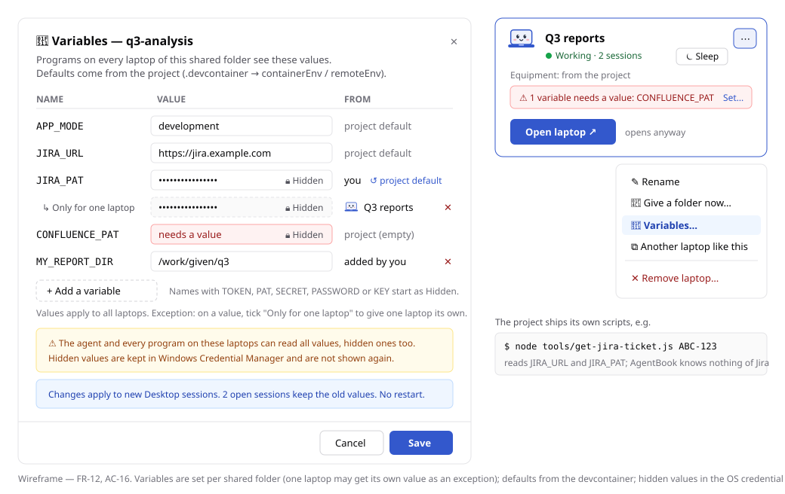
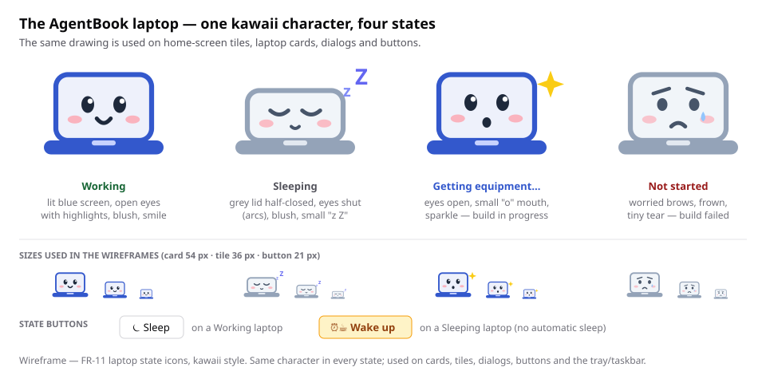
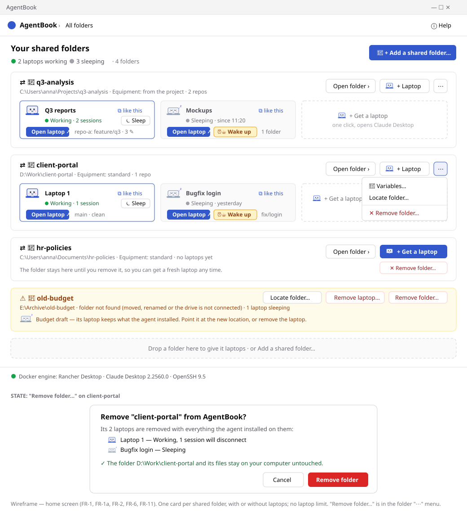
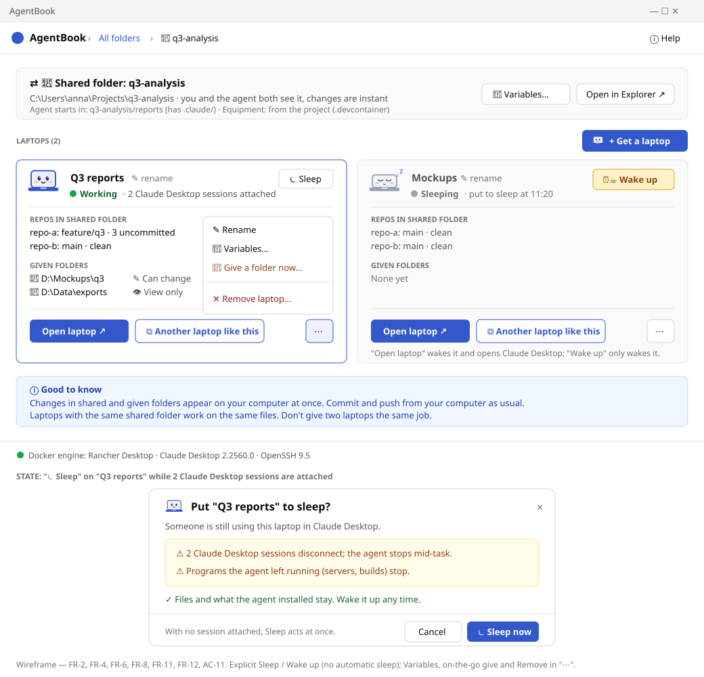
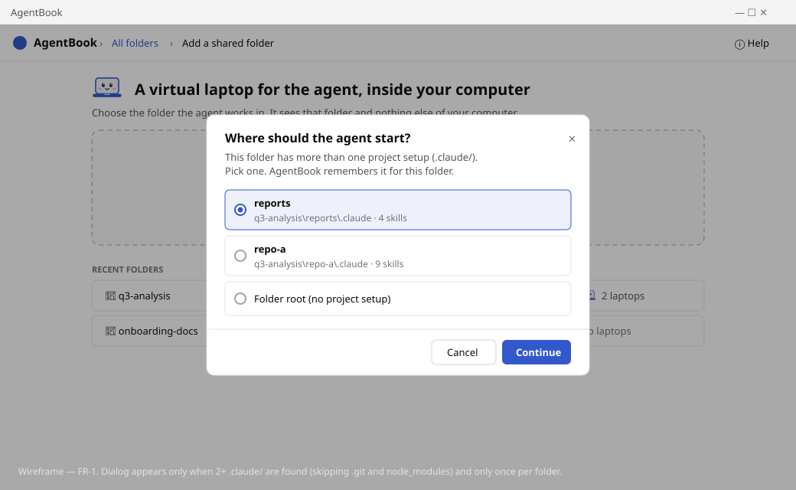
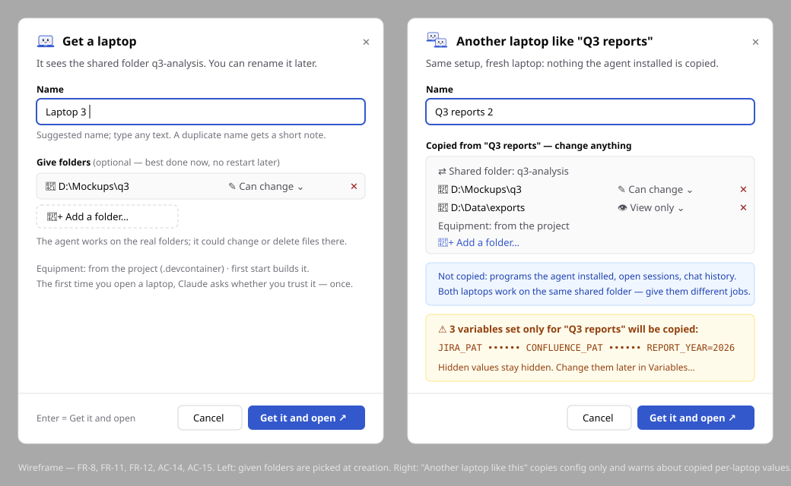
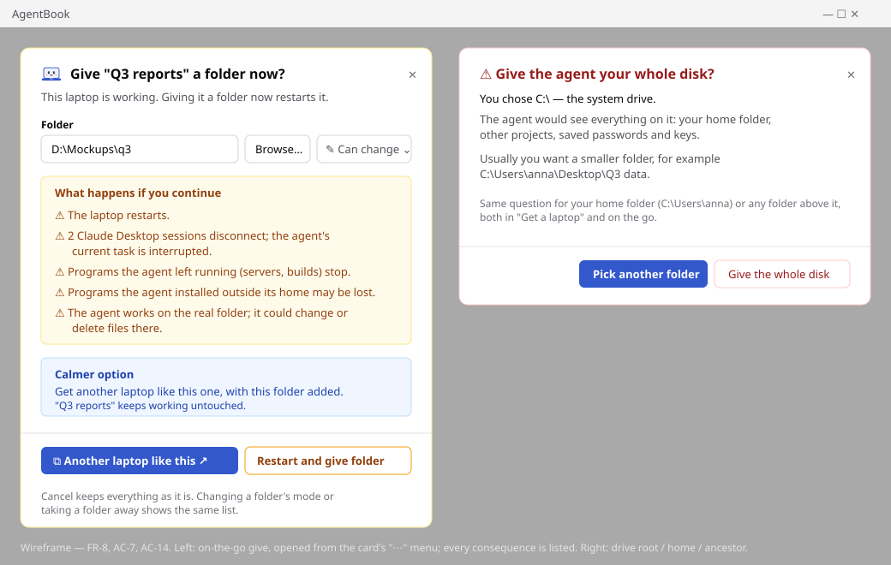
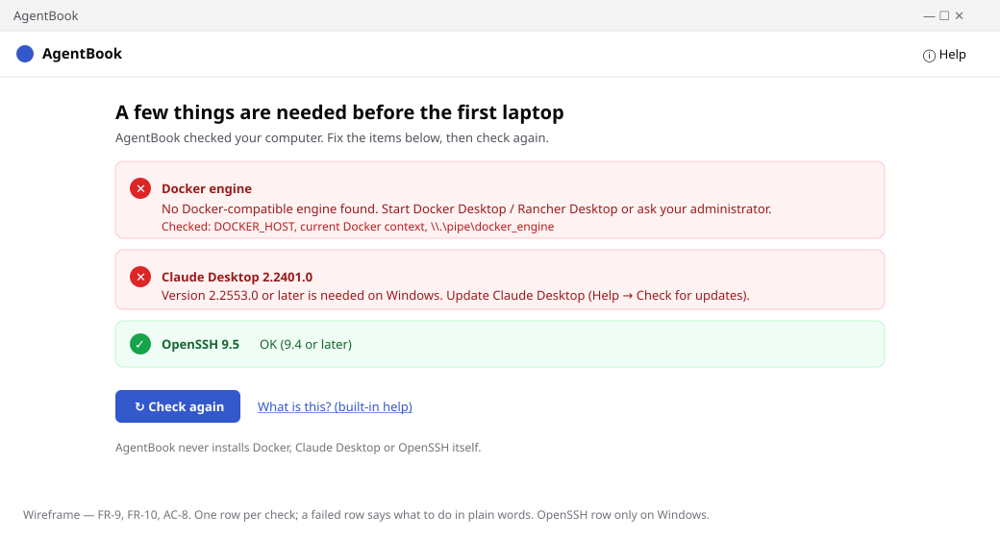
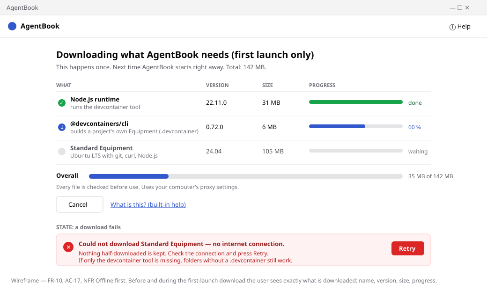
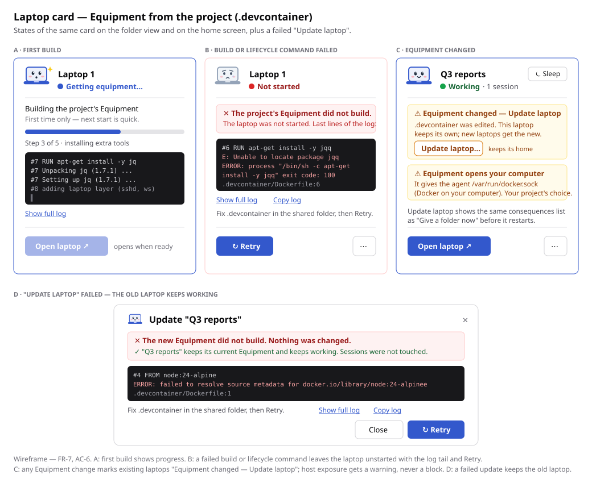

# 2026-11-25-local-sandbox-tool: Local Sandbox Tool: Reusable Isolated Claude Slots on a Folder

**Status:** todo
**Priority:** medium
**Type:** feature
**Module(s):** new sub-product (local desktop tool) in its own top-level folder of this repo, next to `work-hub/`
**Owner:** denis.tsyplakov
**Created:** 2026-11-25
**Tracker:** GH-181 https://github.com/DataArt/artisyn-log-hub/issues/181

## Description

The main idea, from the owner: **a business analyst works in Claude Desktop in an isolated container,
easily and with one click.**

**Design principle: simple by default, complex through the project.** The tool is for people who
are not technical, so the tool itself has no settings or knobs beyond what such a user needs. Anything
advanced (a custom image, extra tools, mounts, environment, setup scripts) is done by the project's
devcontainer config and scripts, which the tool honours. A request for a new setting in the tool is
answered first with "can the devcontainer do it?". Calibration from the owner: a target user could
not create a `.env` file even with screen-sharing help, so nothing may change state behind the
user's back (no automatic sleep) or require editing files.

The tool is a Rust desktop application with a native Rust UI (not Tauri or another webview shell)
that runs **strictly locally**. It never talks to Work Hub. It lives in its own top-level folder of
this repo, next to `work-hub/`.
The user points the tool at a folder and gets a few reusable **slots**, which are persistent Claude
Desktop connections. Opening a slot starts Claude Code inside a local Docker container where the
folder is **mounted live, read-write**. What Claude changes in the folder appears on the host at once.
The user reviews it in their IDE and commits or pushes from the host with their own git credentials.
The BA keeps 2–3 slots and switches between them. Skills from the folder's `.claude/` are loaded.

**What "isolated" means here:** the container sees only the chosen piece of the host filesystem
(see the Security NFR); the rest of the host — other folders, the home folder, the user's
credentials, host processes — is invisible. Everything else Claude does stays in the container:
- processes;
- installed packages and tools;
- system configuration;
- git configuration and credentials inside.

The top folder may not be a git repository, or it may contain several, so the tool does not depend
on git.

**Threat model.** Only Claude inside the container is untrusted. The user's choices and the
folder's devcontainer config are trusted.

Mechanism: Claude Desktop's **SSH environment**. Claude Code runs inside the container, and Desktop
is only the chat UI. The comparison of options is in
`docs/tasks/todo/2026-11-25-wh-isolated-agent-env/research/connection-options.md`.

## Functional Requirements

- FR-1 Folder selection: the user drags in a folder or picks one from recent folders.
  - The tool scans the folder, skipping `.git` and `node_modules`.
  - No `.claude/` is found: Claude starts in the folder root.
  - One is found: Claude starts in the folder that contains it.
  - Several are found: the tool asks once per folder and remembers the answer.
- FR-1a Home screen: the tool opens on a list of every shared folder the user has added, including
  folders with no laptops (so removing a laptop to recreate it never loses the folder). Each folder
  card shows its path, its Equipment and its laptops (name, Working/Sleeping, attached sessions, an
  "Open laptop" button). It also has "Get a laptop", a link to the folder's own laptop view and
  "Remove folder". A folder whose path no longer exists stays in the list with a warning and offers
  "Locate folder…" or "Remove laptop". "Add a shared folder…" and drag-and-drop start FR-1.
  - "Remove folder" takes the folder off the list after a confirmation that names its laptops; they
    are removed as in FR-6. The folder on disk is never touched.
  - "Locate folder…" re-points the shared folder and recreates its laptops with the new bind path,
    keeping their volumes, after a confirmation (the FR-8 on-the-go consequences dialog).
  - "Open laptop" checks every bind source (shared and given folders) before starting. A missing one
    blocks the start with a plain message naming it and offers "Locate folder…" (or, for a given
    folder, removing it); Docker never mounts an empty stand-in directory.
- FR-2 Reusable slots: a folder can have any number of slots; there is no count setting and no
  cap, only the machine's memory limits it. No slot exists until the user adds one. A slot is a
  persistent pair: a stable `~/.ssh/config` alias (`sbx-<internal id>`, never derived from the
  user-visible name) and one container with its own volume.
  - Desktop asks "Trust this workspace?" per alias + folder, so the BA sees it only the first time a
    slot is opened.
  - There are no workstreams to create. The UI has two buttons:
    - "Add slot" creates a slot and connects to it straight away.
    - "Open" connects to an existing slot. It starts a stopped container, rewrites the alias's port
      only if the slot's port had to be reallocated (FR-4) and opens the `claude://` link.

    Everything else happens by talking to Claude inside the slot.
  - Sleep is explicit: the tool never stops a laptop by itself (no idle timer). Each Working laptop
    has a "Sleep" button, which stops the container and keeps its volume. If sessions are attached,
    it first asks for confirmation, saying that N Desktop sessions disconnect and programs the agent
    left running stop. Each Sleeping laptop has a "Wake up" button (alarm clock, then coffee cup
    icon) that starts the container without opening Desktop; "Open laptop" also wakes it and then
    opens Desktop. Containers keep running when the tool exits; a laptop
    whose container was stopped outside the tool (engine or host restart) shows as Sleeping.
  - Setting up slots needs no form: the image is the folder's devcontainer, else the standard image
    (below). There are no settings: no "Advanced" section, no image override and no internet on/off
    switch (Claude Code inside always needs the network).
  - The **standard Equipment** (used when the folder has no devcontainer) is a
    recent Ubuntu LTS image with at least git, ca-certificates, curl and Node.js. Python is not
    required.
  - The slot volume covers the SSH user's home folder, including `~/.claude/remote`, so the Claude
    Code CLI is downloaded once per slot. Everything
    outside it (system packages, `/usr`, `/etc`, `/tmp`) may be lost whenever the container is
    recreated (giving a folder, Update laptop, Locate folder, port reallocation); this is accepted, and the tool does not
    commit the container to an image. The generated instructions (FR-4b) tell Claude so.
- FR-3 Live source folder:
  - The source folder is bind-mounted read-write at `/work/<folder>` (or the devcontainer's workspace
    folder, FR-7) in every slot of that folder. No
    copy is made and there is no merge-back step. Changes are on the host immediately.
  - The tool sets the container's global git config to match a Windows/macOS working tree, so git
    inside does not report every file as changed:
    - `core.fileMode=false`;
    - `core.autocrlf` = the host's effective global value (falling back to the system value), read on
      every Open; `true` on Windows and `input` on macOS when the host has no git. Repo-level values
      in `.git/config` are shared through the mount and left alone;
    - `safe.directory=*`, because ownership on the bind mount differs.
  - Whatever user the agent runs as inside (root included), files it creates or changes in the
    shared and given folders are owned by the host user on the host and stay fully readable and
    editable from the host IDE and git, with no `chown` or admin rights needed (Docker Desktop's
    Windows and macOS file sharing maps them to the host user; the macOS release re-checks it).
  - No git credentials are put into the container. If git inside has its own credentials (for
    example from a devcontainer), that is the user's choice. Otherwise the user pushes from the host.
- FR-3a Parallel work and conflicts are left to Claude and the user. The tool does not manage
  branches, worktrees or merges. The generated instructions (FR-4b) tell Claude:
  - The folder is live and shared with the user's IDE and with the other slots of this folder.
    Another slot or the user may change the same files at the same time. Warn the user when a line
    of work is likely to collide.
  - For a separate line of work in one of the git repos, prefer a branch in a git worktree. Create it
    in an ignored folder inside the repo (for example `.worktrees/<name>`) and remove it when the work
    is done. The worktree is for use inside the container only: git records container paths
    (`/work/<folder>/...`), so the host's git does not see it as a valid worktree. The user reviews
    the branch on the host once it is committed. The tool requires no particular git version.
  - A part of the folder that is not a git repo has no worktrees. Say so and let the user decide.
  - Commit when the user asks. Do not push unless the user asks and credentials are available inside.

  The user decides how to work. The instructions only advise.
- FR-4 Container and Desktop connection:
  - Container requirements: Desktop's SSH-remote requirements (glibc 2.17+ or musl, a POSIX shell,
    `~/.claude/remote/` not on a `noexec` mount, about 1 GB free).
  - The tool adds a layer on top of any base image or devcontainer image with `sshd`, an SFTP
    subsystem and the `ws` CLI. A base image that cannot take this layer gets a plain message.
  - Each slot gets an SSH endpoint published on loopback only, on a fixed host port allocated once
    when the slot is created (`127.0.0.1:<port>:22`), so the alias stays valid even when the container
    was started outside the tool (engine or host restart, `docker start`). The port is reallocated,
    and the alias rewritten, only when it clashes with another program. Docker fixes port bindings
    at create time, so reallocation recreates the container (volume kept). "Open laptop" does this
    without a dialog, because no session can be attached while the port is taken, and shows a one-line
    note. Until then, a container started outside the tool fails to start while its port is taken.
  - The host key is generated once per slot, kept on the host next to the slot's client key, and
    mounted read-only into every container of that slot, so its fingerprint survives every recreate.
    The tool pre-seeds it in the alias's own known_hosts file, so Desktop shows no fingerprint prompt.
    sshd accepts only the slot's tool-generated key; password and keyboard-interactive login are
    off, and root login is off unless the resolved SSH user is root (then `prohibit-password`, key only).
  - sshd is started by a tool wrapper entrypoint that then runs the image's or devcontainer's original
    command, so it also runs after a plain `docker start`, an engine restart and with
    `overrideCommand`; `postStartCommand` or `docker exec` alone is not used.
  - SSH logs in as the devcontainer's `remoteUser`, else its `containerUser`, else a tool-created
    `claude` user (also when the image's default user is root). An explicit `root` is respected. The
    slot volume, the home folder and the generated files belong to that user.
  - Tool-owned files in the laptop (`ws`, the generated CLAUDE.md, the prompt hook) are refreshed on
    every Open, so a laptop created by an older tool version keeps working after an upgrade. A change
    to the laptop layer image itself marks the laptop "Equipment changed" (FR-7). The `ws`
    state-directory format only gains fields, so older `ws` binaries keep reading it.
  - The aliases live in a tool-owned ssh config file, pulled into `~/.ssh/config` by one `Include`
    line the tool adds once; the user's own blocks are never edited.
  - The tool writes the slot's alias and opens
    `claude://code/new?ssh_host=<alias>&ssh_folder=<path>`, so Desktop lands in Claude's start folder
    with "Worktree" off.
  - The tool shows how many Desktop sessions are attached to each slot. The count (also shown in
    the Sleep, Remove and on-the-go warnings) uses the simplest non-invasive method, for example
    counting established SSH connections to the slot's sshd from outside; the exact method and poll
    interval are a plan decision and may be refined later. The count is shown as-is; only zero versus
    non-zero is guaranteed. A session is detached once its SSH connections close.
- FR-4a `ws` CLI inside the container:
  - `ws whoami`:
    - the slot and the source folder;
    - for every git repo in the folder: its current branch, its local branches, its worktrees and
      uncommitted changes;
    - the other slots of this folder (running or idle), read from a tool-owned state directory
      mounted read-only into every slot (not a single-file mount); the tool replaces files in it by
      write-then-rename and `ws` re-reads them on every call, so a rename shows up without a
      restart. There is no control channel to the tool.
  - `ws mounts`: the connected host folders and their modes.
  - A skill in the container teaches Claude to use these commands.
- FR-4b Context for Claude:
  - The tool generates a user-level `~/.claude/CLAUDE.md` in the container, outside the project
    folder. It describes:
    - the slot;
    - its connected folders and their modes;
    - the `ws` commands;
    - the parallel-work advice from FR-3a;
    - that only the home folder (the slot volume) and the mounted folders survive a container
      recreate: anything installed or written elsewhere (system packages, `/usr`, `/etc`, `/tmp`) may
      be lost, so it should hold nothing but temporary files.
  - A `UserPromptSubmit` hook adds one line to every prompt, for example "slot 2 · repo-a:
    feature/q3 (3 uncommitted)", and a line when the connected folders change. Claude always knows where it
    is. The hook stays fast: the branch is read from `.git/HEAD`, the uncommitted count from
    `git status --porcelain -uno` with a ~1 s timeout (shown as "?" when it runs out) and cached per
    repo for a few seconds; the full status is left to `ws whoami`.
  - The user's `~/.claude/skills`, `agents` and `commands` are copied in on every "Open", replacing
    the in-container copies of the same names. Nothing is copied back. `.credentials.json` and
    other secrets never are; Desktop handles the sign-in over SSH.
- FR-6 Remove a slot ("Remove laptop"): removing a slot in the tool always asks for confirmation
  (whether or not sessions are attached), then stops the container, deletes the slot's volume
  (system state, caches), removes its `~/.ssh/config` alias and forgets the laptop entirely (name,
  given folders, per-laptop variable values); the card disappears. The source folder is not
  touched. There is no separate reset: to start clean, the user removes a laptop and gets a new one.
- FR-7 Devcontainer:
  - If the folder has `.devcontainer/devcontainer.json` or `.devcontainer.json`, the image is built
    with the official `@devcontainers/cli` (with its Node runtime, downloaded on first launch,
    FR-10), with no restrictions. The tool asks when several
    configs are found.
  - Create-time settings of devcontainer.json (`mounts`, `containerEnv`, `runArgs`,
    `remoteUser`/`containerUser`, lifecycle commands) are applied as `devcontainer up` would apply
    them; the mechanism is a plan decision.
  - A devcontainer's `workspaceFolder` / `workspaceMount` wins over `/work/<folder>`: the shared
    folder is mounted there, and `ssh_folder`, `ws`, the generated CLAUDE.md and
    `${containerWorkspaceFolder}` use that path. The tool's own run arguments (loopback SSH port,
    slot volume, given folders, state mount) are always added on top and cannot be overridden by
    `runArgs`.
  - The built image is cached by config hash. A first build shows progress.
  - A failed build or failed lifecycle command leaves the laptop unstarted, shows the log tail and
    offers Retry.
  - When any Equipment source changes (the devcontainer config hash, or the standard Equipment or
    laptop layer shipped with a new tool version), existing laptops keep their
    current image and their card shows "Equipment changed — Update laptop". This is checked at tool
    start and before every Open. Updating uses the FR-8 on-the-go consequences dialog and keeps the
    volume. New laptops use the new image.
  - "Update laptop" builds the new image first and replaces the container only after a successful
    build and lifecycle commands; on failure the old container and image stay and keep working, and
    the dialog shows the log tail and Retry.
  - The tool records the libc family of each laptop's image. When "Update laptop" switches it (for
    example a devcontainer moved from Debian to Alpine), the tool clears `~/.claude/remote/ccd-cli` in the kept volume so
    Desktop downloads the matching CLI build; the rest of the home folder stays.
  - If the devcontainer exposes the host to the container (writable mounts, the Docker socket), the
    tool shows a warning naming it but does not block it.
- FR-8 Extra host folders: the user connects any host folder to a slot, for example a
  mockups folder outside the project.
  - **Main path: at creation.** Given folders are chosen in the "Get a laptop" dialog (FR-11), so the
    container is created with its mounts and nothing restarts.
  - **On the go: allowed, with warnings.** "Give a folder" on an existing laptop is a secondary
    action (in the card's "⋯" menu) that always asks for confirmation, whether or not sessions are
    attached. Its dialog lists every consequence before the confirm button
    ("Restart and give folder"): the laptop restarts, the N attached Desktop sessions disconnect and
    Claude's current task is interrupted, programs the agent left running stop, and what the agent
    installed outside its volume may be lost. It also suggests "Another laptop like this" with the
    folder added as the calmer option. The same dialog applies to changing a given folder's mode or
    removing it.
  - By default it is a **live read-write mount**: Claude works on the real folder. The owner accepts
    the risk that Claude could change or delete its contents. The tool shows a short one-line note
    about it.
  - A read-only mount is an option per folder.
  - A given folder is mounted at `/work/given/<basename>`, with a `-2`, `-3` suffix on a basename
    collision. Folder names (spaces, non-ASCII) are kept as-is in container paths, for the shared
    folder's `/work/<folder>` too, and URL-encoded in the `claude://` link. `ws mounts` shows each
    container path next to its host path.
  - Exactly the chosen folder is mounted: never its parent, never the whole filesystem.
  - The tool asks for explicit confirmation before connecting the system drive root, the user's
    home folder or an ancestor of it, because Claude would get the whole disk.
  - Docker cannot add a bind mount to a running container, so giving a folder on the go recreates
    the container. The volume is kept.
  - Claude learns about the connected folders through FR-4b.
- FR-9 Docker engine: the tool connects to any engine that provides the Docker API, through
  `DOCKER_HOST`, the current Docker context, the Windows named pipe or the macOS socket. If none is
  reachable, it shows a plain message: "No Docker-compatible engine found. Start Docker Desktop /
  Rancher Desktop or ask your administrator." It does not offer installs.
- FR-10 Prerequisite check: at start, the tool checks the engine and, on Windows, OpenSSH 9.4 or later.
  Each failure shows a plain message saying what to do. The Claude Desktop version is not checked: a
  Desktop too old for the SSH link simply fails to open it, and the user updates Desktop (owner).
  - On its first launch the tool downloads its dependencies (the `@devcontainers/cli` and its Node
    runtime, and what the standard Equipment needs). Before and during the download it tells the user
    that it is downloading dependencies and lists exactly what (name, version, size) with progress.
  - Versions are pinned, with SHA-256 checksums shipped in the tool; a file is used only after its
    checksum matches. This covers the files the tool downloads itself and the standard base image (by
    digest); distro packages installed inside image builds (apt/apk) are verified by the distro's
    signatures instead (owner). Downloads go to the tool's per-user data folder and use the system proxy
    settings; the download source is a plan decision.
  - A failed or offline download shows a plain message with Retry; nothing half-downloaded is used.
    Folders without a devcontainer stay usable if only the devcontainer CLI is missing.
- FR-12 Variables (environment variables for programs in the laptop). The tool provides the
  mechanism only and knows nothing about what the variables are for (a project may ship, say, a
  `tools/get-jira-ticket.js` that reads `JIRA_URL` and `JIRA_PAT`).
  - Defaults: the names and values of the devcontainer's `containerEnv` and `remoteEnv`
    (`${localEnv:…}` resolved as the devcontainer CLI does). An empty default means "needs a value".
  - Values are set per shared folder and apply to all its laptops by default ("Variables…" in the
    laptop card's "⋯" menu and on the folder view). The user can override a default, reset it to the
    project default, add a variable the devcontainer does not declare, and remove an added one.
  - As an exceptional case, a value can be marked "Only for one laptop" (for example a different PAT
    for one laptop). That laptop then sees its own value instead of the folder-wide one; the dialog
    shows it as a sub-row under the variable, and removing it falls back to the folder-wide value.
  - A value can be marked **Hidden**: masked in the UI and kept in the OS credential store
    (Windows Credential Manager; macOS Keychain), never in the tool's own files, the `ws` state
    directory, the generated CLAUDE.md or logs. Names containing `TOKEN`, `PAT`, `SECRET`,
    `PASSWORD` or `KEY` start as Hidden.
  - Every process started in a Desktop session sees the effective values (sshd sessions do not
    inherit the container's env, so the tool delivers them to each session; the mechanism is a plan
    decision). A change needs no container recreate: it applies to new sessions, and the dialog says
    how many open sessions keep the old values.
  - A variable that still needs a value shows a note on the laptop card; "Open laptop" still works.
  - The generated CLAUDE.md lists variable names (never values), so Claude knows they exist.
  - The dialog says that the agent and every program on the laptop can read all values, hidden ones
    too.

- FR-11 UI vocabulary. The UI uses the metaphor **"a virtual laptop for the agent inside your OS"**.
  The working product name is **AgentBook**. "Claude" is not used in the product name.
  - Laptop names:
    - "Get a laptop" opens one dialog: a name field pre-filled with a suggestion ("Laptop 1"), which
      the user can replace with any text ("Q3 reports", "Mockups"), and an optional list of given
      folders with their modes. Enter confirms; with no edits it is still one step to Desktop.
    - A laptop can be renamed at any time from the tool.
    - The name is display-only. The SSH alias and the container keep a stable internal id, so a
      rename never brings back the "Trust this workspace?" dialog.
    - The name appears in the tool, in `ws whoami` and in the prompt hook line.
    - Names must be unique per shared folder. A duplicate gets a short note, not a block.
  - **"Another laptop like this"** (on every laptop card and tile) opens the same dialog pre-filled
    with that laptop's configuration: the same shared folder, given folders and their modes,
    Equipment, and the name "<name> 2". It copies configuration only: the new
    laptop gets its own container and empty volume, with nothing the agent installed, no sessions
    and no history. It also copies the source laptop's "Only for one laptop" variable values; when
    there are any, the dialog warns before confirming, naming them (for example "3 variables set only
    for "Q3 reports" will be copied: JIRA_PAT, …"; hidden values stay masked). Everything stays
    editable before "Get it and open".
  - The **shared folder** is the root folder the user pointed the tool at; folders the user connects
    are **given** folders.

  | Spec term | UI term | Icon / state |
  |---|---|---|
  | Slot | **Laptop** ("Laptop 1", renamable, e.g. "Laptop: Q3 reports") | laptop icon |
  | Add slot | **Get a laptop** | |
  | Open slot | **Open laptop**, which opens Claude Desktop on it | lid open |
  | Stop a slot | **Sleep** (button on a Working laptop) | lid closing |
  | Start a stopped slot | **Wake up** (button on a Sleeping laptop) | alarm clock, then coffee ⏰☕ |
  | Stopped slot | **Sleeping** | kawaii sweetly sleeping laptop: lid half-closed, eyes shut, blush, "z z Z" |
  | Running slot | **Working** | the same kawaii laptop awake: screen lit, eyes open, smiling |
  | Source folder | **Shared folder**: "you and the agent both see it, changes are instant" | folder with arrows |
  | Connect a host folder | **Give a folder** ("Give this laptop a folder…") | folder + |
  | New slot with a copied config | **Another laptop like this** | two laptops |
  | Read-only mount | **View only** | eye |
  | Devcontainer image | **Equipment** ("programs on this laptop: from the project / standard") | |
  | Remove slot | **Remove laptop**: deletes the laptop and what the agent installed, never touches the folders | |
  | Environment variables | **Variables** (secret value: **Hidden**) | key |

  - The same words are used inside: `ws whoami` answers "I'm on laptop "Q3 reports"; shared folder:
    <name>; repo-a: feature/q3", and the prompt hook line reads "Q3 reports · repo-a: feature/q3".
  - Help text covers the two places where the metaphor misleads:
    - "Changes in shared and given folders appear on your computer at once."
    - "Laptops with the same shared folder work on the same files. Don't give two laptops the same
      job."
  - The one-time "Trust this workspace?" dialog is explained as "the first time you open a laptop,
    Claude asks whether you trust it — once".

## Non-Functional Requirements

- Usability: a non-technical user goes from folder to a working Claude Desktop session with one
  click. There is no terminal and no config editing.
- Platforms: Windows 11 and macOS are the targets. The first release is Windows 11 only, but the
  design must not need rework for macOS: every OS-specific piece (Docker endpoint, credential store,
  ssh config and known_hosts paths, `claude://` launch, path handling, git defaults) sits behind one
  platform layer, and no Windows-only assumption leaks into the rest of the tool.
- Distribution: the tool is a single exe that runs as-is, with no installation. For convenience an
  installer is shipped, for now Windows only. All it does is copy the exe into a per-user folder (no
  admin rights) and create a shortcut. Neither is code-signed. The help and the download page
  explain the one-time SmartScreen step ("More info" → "Run anyway"). The tool keeps its own data in
  the per-user data folder, not next to the exe, so the installed copy and a copy run straight from
  Downloads see the same laptops. An update is a newer installer run over the old install (or a newer
  exe); laptops, folders and settings are kept (FR-4).
- Offline first: the tool's help ships inside the tool. The first-launch dependency download (FR-10)
  is the one step that needs the network besides Claude itself.
- Performance: plain bind mounts of the shared and given folders are acceptable on Windows. The
  target users are business analysts without heavy build workloads, so no per-slot volume overlay
  for heavy folders (for example `node_modules`) is planned.
- Security: the host is visible to the container only through the source folder, the folders the
  user connected and the devcontainer's own mounts. Nothing outside them can be read or changed from
  the container.
- Accepted risk (owner): the agent can read the user's own Claude OAuth token, because
  Desktop passes it to the CLI's environment in the container. No egress restriction is added for it.
  The same holds for FR-12 variables, Hidden ones included: the user puts them there for programs in
  the laptop, and the agent can read them too.

## Acceptance Criteria

- [ ] AC-1 (FR-1, FR-2, FR-4): a folder holding two git repositories and some plain files opens in
      Claude Desktop with one click. Skills from its `.claude/` are available. A 4th and 5th laptop
      on the same folder are added with no note and no limit.
- [ ] AC-2 (FR-1): a folder with two `.claude/` directories asks once which to use, and does not ask
      again next time.
- [ ] AC-3 (FR-3):
      - A file Claude edits in `/work/<folder>` shows up changed in the user's IDE on the host at
        once.
      - A package Claude installs exists only in the container.
      - `git status` inside and on the host show the same changes, with no spurious mode or
        line-ending diffs.
      - The user commits and pushes the change from the host.
- [ ] AC-4 (FR-2): closing and reopening a slot from the tool reconnects with no new "Trust this
      workspace?" dialog. The Claude Code CLI is not downloaded again.
- [ ] AC-4a (FR-2, FR-3a, FR-4a): a BA opens 2 slots on the same folder and works in each.
      - Asked in slot 1 "where am I", Claude answers from `ws whoami` with the slot, the branch and
        the uncommitted changes of each repo.
      - Asked for a second line of work in `repo-a`, Claude creates a worktree in an ignored folder
        inside the repo, works in it from inside the container, and removes it when done; the
        committed branch is visible to the host's git.
      - Before editing a file that the other slot is also changing, Claude warns the user.
      - With Desktop sessions on slot 1 and none on slot 2, the tool shows a non-zero count for
        slot 1 and "0" for slot 2.
- [ ] AC-6 (FR-7): a folder with a devcontainer that installs an extra tool gives Claude that tool.
      Its first build shows progress, and the second start is quick.
      - A devcontainer that mounts `/var/run/docker.sock` shows a warning naming it, and the laptop
        still starts.
      - After `devcontainer.json` is edited, the existing laptop shows "Equipment changed — Update
        laptop" and is rebuilt and recreated only after confirmation, with its volume kept.
      - A broken Dockerfile leaves the laptop unstarted, with the log tail and Retry.
      - A broken Dockerfile during "Update laptop" leaves the old container working.
      - Switching the devcontainer's base image from Debian to Alpine and running "Update laptop"
        keeps the volume, and Desktop connects with a freshly downloaded CLI.
- [ ] AC-7 (FR-8): a folder outside the project, connected mid-session, is visible to Claude after the
      reconnect. A file Claude writes there appears on the host. With
      the read-only option, writing fails. From inside the container, the user's home folder and other host
      paths that were not connected are not visible. Connecting `C:\` or the home folder asks for
      confirmation first. Switching a given folder to View only, or removing it, shows the
      consequences dialog; afterwards writes fail (or the folder is gone) and `ws mounts` shows it.
      The first prompt of the next session carries the connected-folders line.
- [ ] AC-7a (FR-4, FR-4a, FR-4b):
      - A plain Debian image and an Alpine image both open from the link on Windows 11 (macOS when its
        release lands).
      - A user-level skill from the host works in the session, and no host `.credentials.json` exists
        in the container.
      - A devcontainer built on a distroless or scratch image shows the plain "cannot add the laptop
        layer" message.
      - A devcontainer with `remoteUser: root` connects as root with the key; a password login is
        refused. A file Claude creates in the shared folder as root is owned by the host user and
        can be edited, renamed and deleted from the host without admin rights.
      - After `docker restart` of the container from outside the tool, the alias connects with no
        fingerprint prompt.
- [ ] AC-8 (FR-9, FR-10): with Docker stopped, or (on Windows) OpenSSH older than 9.4, the tool shows
      the matching plain message naming what to update.
- [ ] AC-9 (FR-6, FR-1a): "Remove laptop" asks for confirmation, then removes the container, its
      volume, its `sbx-<id>` alias and its card. The shared and given folders stay byte-identical. The
      shared folder stays on the home screen with no laptops, and the next "Get a laptop" downloads
      the CLI again. "Remove folder" then takes the folder off the list, leaving it on disk.
- [ ] AC-20 (Distribution): on a clean Windows 11 machine without admin rights:
      - The exe started straight from Downloads (after the SmartScreen "Run anyway" step) works with
        no installation.
      - The installer copies the exe into a per-user folder and creates a shortcut; the shortcut
        opens the tool and shows the laptops created from the Downloads copy.
      - Running a newer installer over it keeps existing laptops and folders.
- [ ] AC-10 (FR-11): renaming "Laptop 1" to "Q3 reports" changes the name in the tool, in
      `ws whoami` and in the prompt hook line, and the next "Open laptop" shows no "Trust this
      workspace?" dialog. A duplicate name shows a note and is saved. A rename made while the
      container runs shows up in `ws whoami` without a restart.
- [ ] AC-11 (FR-2): a laptop left with no Desktop session for hours stays Working. "Sleep" on a
      laptop with no session stops it at once and shows "Sleeping"; on a laptop with a session it
      first asks, saying how many sessions disconnect. "Wake up" brings it back to Working without opening Desktop, and "Open laptop" wakes it and opens
      Desktop, both with the volume's state
      intact.
- [ ] AC-12 (FR-4): the slot's SSH port is not reachable from another machine on the LAN, and a
      password login is refused.
- [ ] AC-13 (FR-1a): with laptops on two folders, the tool opens on a list of both folders and their
      laptops, and "Open laptop" there opens Claude Desktop in one click. A folder that has been
      moved away stays in the list with a warning, and "Open laptop" on it refuses with a message
      naming the folder. "Locate folder…" re-points it; after a confirmation its laptops are
      recreated with their volumes kept.
- [ ] AC-14 (FR-8, FR-11): a laptop created with a given folder in the "Get a laptop" dialog sees it
      from its first session, with no restart. Giving a folder to a running laptop shows the full
      list of consequences and acts only after "Restart and give folder".
- [ ] AC-15 (FR-11): "Another laptop like this" on "Q3 reports" (two given folders, one View only)
      creates "Q3 reports 2" with the same shared folder, given folders and modes and the same
      Equipment, but a new container and an empty volume: a package installed on "Q3 reports" is not
      there. If "Q3 reports" has a `JIRA_PAT` value "Only for one laptop", the dialog names it before
      confirming, and "Q3 reports 2" gets the same value.
- [ ] AC-16 (FR-12): a folder whose devcontainer declares `containerEnv` `JIRA_URL` (a URL) and
      `JIRA_PAT` (empty) and ships `tools/get-jira-ticket.js`:
      - The laptop card shows "1 variable needs a value"; "Open laptop" still opens.
      - The user enters the PAT in "Variables…" (it starts as Hidden). In a new Desktop session
        `node tools/get-jira-ticket.js ABC-123` gets the ticket, with no container recreate.
      - The PAT value is not in any tool file on the host, in the `ws` state directory or in the
        generated CLAUDE.md; it is in Windows Credential Manager.
      - Overriding `JIRA_URL`, then "↺ project default", restores the devcontainer value in the next
        session. A variable added in the dialog is visible to `printenv` in a new session.
      - Marking a `JIRA_PAT` value "Only for one laptop" on "Q3 reports" gives that laptop its own
        value in new sessions while the other laptops of the folder keep the folder-wide value.
- [ ] AC-17 (FR-10): on a clean machine the first launch lists each dependency (name, version,
      size) with progress, and the second launch downloads nothing. With the network cut
      mid-download, the tool shows the failure message and Retry, and no half-downloaded file is used.
- [ ] AC-18 (FR-4): with another process listening on a stopped laptop's port, "Open laptop" picks a
      new port, rewrites only that alias, and Desktop connects with no fingerprint prompt and no new
      "Trust this workspace?" dialog.
- [ ] AC-19 (FR-4, FR-7): a laptop created by tool version N opens and `ws whoami` works after the
      tool is upgraded to N+1.

## Open Questions

_None open._

## Common sense considerations

- FR-5 / AC-5 numbering gaps are kept; nothing is renumbered, so existing references stay valid.
- Remove laptop and laptop naming get AC-9 and AC-10.
- Sleep is an explicit "Sleep" button, no automatic idle stop: non-technical users can't be expected to understand idle rules (owner); containers outlive the tool.
- Simple tool for non-technical users; anything advanced goes through the devcontainer and project scripts (owner).
- "Another laptop like this" copies "Only for one laptop" values and names them in a warning first (owner).
- The Variables dialog stays as specified: filling boxes is fine for the target users, files are not (owner).
- No "Advanced" section for now: no slot count, image override or internet switch (owner).
- User skills/agents/commands are copied on every Open, host wins, nothing is copied back.
- AC-8 covers the engine and the Windows-only OpenSSH floor; AC-4a checks the session count.
- No Claude Desktop version check: an old Desktop fails to open the link and the user updates it (owner); the prerequisites wireframe's Desktop row is not built.
- Distro packages (apt/apk) inside image builds are trusted via distro signatures, not SHA-256 pins (owner).
- SSH is published on loopback only, key-only (AC-12).
- SSH user: `remoteUser`, else `containerUser`, else a tool-created `claude` user.
- Devcontainer create-time settings are applied as `devcontainer up` would; `build` vs `up` is a plan decision.
- No slot exists up front; the number of laptops is unlimited, only memory limits it (owner).
- Remove laptop deletes the laptop entirely; there is no reset (owner).
- A shared folder stays on the home screen with no laptops; "Remove folder" takes it off the list (owner).
- Distribution: a single exe that also runs without installation; a Windows-only installer just copies it to a per-user folder and adds a shortcut; nothing is signed, the user confirms SmartScreen once (owner).
- Giving a folder on the go and Remove laptop always ask first; the give-folder dialog lists every consequence.
- Given folders mount at `/work/given/<basename>` (`-2` suffix on collision); names kept as-is.
- `ws whoami` reads other slots from a read-only mounted state directory (write-then-rename); no control channel.
- "Locate folder…" recreates the folder's laptops on the new path, volumes kept, after confirmation.
- "Open laptop" refuses to start when a bind source is missing, naming the folder.
- A devcontainer's `workspaceFolder` wins over `/work/<folder>`; the tool's own run args are always added on top.
- A failed devcontainer build or lifecycle command leaves the laptop unstarted with the log tail and Retry.
- A changed devcontainer config hash marks existing laptops "Equipment changed — Update laptop"; updating confirms via the FR-8 dialog.
- SSH aliases live in a tool-owned file included from `~/.ssh/config` by one line.
- The prompt-hook line reads the branch from `.git/HEAD` and the dirty count with a ~1 s timeout ("?" on timeout), cached per repo.
- `core.autocrlf` = host's effective global value read on every Open; `true` (Windows) / `input` (macOS) without host git.
- Unsupported-image message, host-exposure warning and Locate folder are covered by AC-7a, AC-6 and AC-13.
- Tool-owned files in a laptop are refreshed on every Open; a layer image change marks "Equipment changed"; the `ws` state format is additive-only.
- First-launch dependencies are pinned and SHA-256 checked, stored per user, use the system proxy; failure shows Retry.
- Port reallocation recreates the container silently with a note (no session can be attached); covered by AC-18.
- An explicit `root` SSH user is respected with key-only `prohibit-password` (owner: root inside is fine as long as host file permissions stay normal); an unset user on a root image gets the `claude` user.
- The sshd host key is generated once per slot on the host and mounted into every container of the slot.
- sshd starts from a tool wrapper entrypoint, so it survives `docker start` and `overrideCommand`.
- A libc-family change clears `~/.claude/remote/ccd-cli` in the kept volume.
- Session count: only zero vs non-zero is guaranteed (owner: simplest method, refine later).
- Any Equipment source change marks "Equipment changed", checked at tool start and before every Open.
- "Update laptop" builds first and replaces the container only on success; the old one keeps working on failure.

## Notes

<!-- Append timestamped notes here as work progresses -->

- 2026-11-25: PoC (Debian + Alpine) confirmed the SSH-environment mechanism — findings in [notes.md](notes.md).
