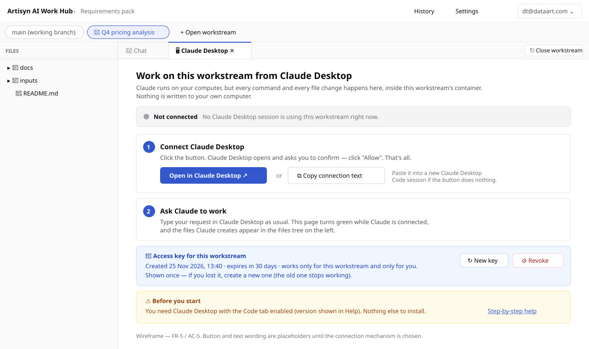
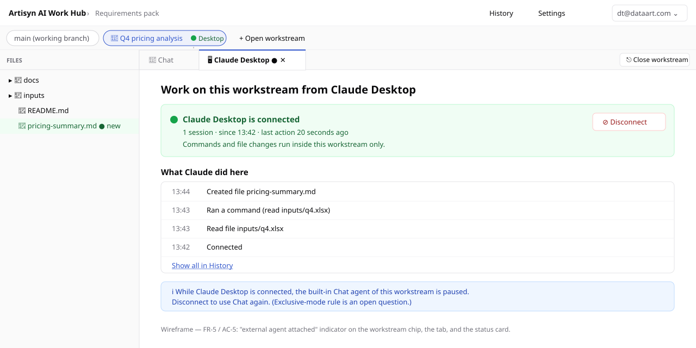
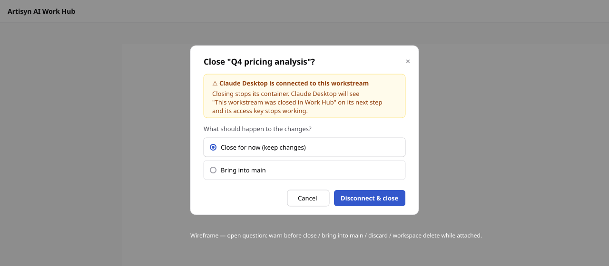

# 2026-11-25-wh-isolated-agent-env: Work Hub as an Isolated Environment for an External Claude Code Agent

**Status:** todo
**Priority:** medium
**Type:** feature
**Module(s):** work-hub
**Owner:** denis.tsyplakov
**Created:** 2026-11-25
**Tracker:** GH-178 https://github.com/DataArt/artisyn-log-hub/issues/178

## Description

Raw idea (verbatim, Russian):

> нужен изолированный режим рабты так чтобы к WH развернутому локально (или не локально) как-то мог
> подключаться claude desktop code
> т.е. агень крутится в нем, а WH/контейнер с окружением используется как безопасная среда

In English: a new isolated working mode is needed. A user works in the Code tab of Claude Desktop,
and the session's environment is a Work Hub workstream container. The Work Hub instance can be
deployed locally or on another machine. The container, with its prepared toolchain, is the safe
place where the agent's commands run and files change.

Today the in-container agent is driven from Work Hub's own chat terminal (see
`docs/knowledgebase/work-hub.md`). This task lets the user drive it from Claude Desktop instead.

### Hard constraints (owner, 2026-11-25)

1. Users send their prompts from **Claude Code in Claude Desktop**. That is the only client they
   use: no terminal CLI, no IDE.
2. **Every change stays in the container.** Whatever the agent does (commands, file edits, package
   installs, git operations, network calls through tools) is isolated inside the container, and
   nothing touches the user's own machine.

### Target users

The users are business analysts and managers, who are **non-technical**. They will not edit JSON
configs, run `docker`, generate SSH keys, or debug a failed connection by hand. Such a person must be
able to set it up and use it day to day, ideally with one click or one copy-paste from Work Hub.

### Chosen mechanism

The mechanism is a Claude Desktop **SSH environment** that points at the workstream container
through an **SSH gateway in Work Hub**. Claude Code runs inside the container, so every tool call
runs there, and Desktop is only the chat UI. The comparison of every option (MCP exec tools,
Anthropic cloud, self-hosted runners, sandboxing, and others) and the reasons for this choice are in
[research/connection-options.md](research/connection-options.md).
## Functional Requirements

- FR-1: From Claude Desktop's Code tab, a user opens an SSH session into one of their Work Hub
  workstream containers. Claude Code runs inside the container, so shell commands, file reads and
  edits all happen there. Desktop's local tools are not part of the session.
- FR-2: It works both for a Work Hub running on the user's own machine and for one running on
  another host reachable over the network. Work Hub exposes one SSH gateway port with a stable host
  key, and SSH encrypts the traffic.
- FR-3: The container is isolated:
  - The attached agent sees only that container's filesystem and processes.
  - It cannot reach the Work Hub host's services (Postgres, Work Hub API, Docker socket, other host
    ports, `host.docker.internal`) or other users' containers.
  - This is new work. Containers move off Docker's default bridge onto per-workstream (or per-user)
    user-defined networks, and `wh-net-<instance>` is kept only for the git proxy.
  - Outbound internet stays available as it is today.
- FR-4: Access uses a per-workstream **attach token**, which is the SSH password:
  - It is shown once on the workstream page with a Copy button and stored only as a hash.
  - It survives a Work Hub restart and is never written into the container.
  - It is valid until revoked. "Revoke" on the workstream page revokes it, and so do discarding the
    workstream and deleting its workspace.
  - It opens only its own workstream.
  - In `AUTH_MODE=none` it follows the same trust model as the web UI in that mode.
- FR-5: The workstream page has a "Claude Desktop" tab:
  - It shows how to connect: an "Open in Claude Desktop" `claude://code/new?ssh_host=…` link
    pre-filled with host, port and folder, the token to paste, and the prerequisites.
  - It shows an "attached" indicator. The indicator is on while at least one SSH connection is open
    and shows the number of sessions and since when.
  - Several Desktop sessions on one workstream are allowed. A person may still use the workstream's
    terminals while one is attached.
- FR-6: The container is the same environment workstreams already use (checkpoint image, configured
  tools, git proxy remotes), so the external agent gets the prepared toolchain. Attach targets
  workstream containers only; the workspace container (Configure) is not attachable.
- FR-7: External-agent mode and the in-container chat agent are exclusive per workstream. While a
  workstream is in external-agent mode:
  - The reconciler does not start or respawn the in-container `chat` agent.
  - No Work Hub secret env (agent token, connection secrets) is passed to any exec in that container.
- FR-8: Lifecycle:
  - Attaching to a stopped or closed-for-now workstream starts its container, the same as reopening
    it in Work Hub.
  - Close, bring into main, discard, merged elsewhere and workspace delete drop live SSH
    connections. Before any of these, the UI warns that Claude Desktop is attached.
  - After a reopen or a reconciler restart, the same Desktop connection works without any
    reconfiguration.
- FR-9: Input documents get into the workstream and results get out through Work Hub's existing file
  area (upload and download). The agent never reads from or writes to the user's machine.

## Non-Functional Requirements

- Security: no secrets of the Work Hub host or of other users leak into the attached session, and
  the rule "Work Hub secrets never go into containers" still holds. The user's own Claude sign-in,
  which Desktop puts on the remote, is not a Work Hub secret.
- Usability: a non-technical user connects with one link click plus one paste of the token. No
  terminal, no hand-edited config, no key generation, and nothing installed locally beyond Claude
  Desktop.
- Prerequisites:
  - Claude Desktop v2.110.0 or later with the Code tab.
  - On Windows, Desktop v2.2553.0 or later and OpenSSH 9.4 or later.
  - The connect tab and the in-app help list them and say what to do when one is missing.
- Container image: meets Desktop's SSH-remote requirements:
  - glibc 2.17+ or musl
  - an SFTP subsystem
  - a POSIX shell
  - `~/.claude/remote/` not on a `noexec` mount
  - about 1 GB free
- Offline first: the connection setup is documented inside the product (in-app help), not only
  online.

## Acceptance Criteria

- [ ] AC-1 (FR-1): from Claude Desktop, an agent asked to create a file and run a command in the
      attached workstream produces the file and the command output inside the container. An agent
      explicitly told to write to the user's home folder writes into the container's home. The
      Desktop session's local folder and the user's home and repo folders on the user's machine stay
      unchanged; the only folder that changes is the workstream's own data folder under
      `WORK_HUB_DATA_DIR`.
- [ ] AC-2 (FR-2): the same flow works against a Work Hub on `localhost` and against one on a
      remote host.
- [ ] AC-3 (FR-3): from the attached session, the host filesystem, the Work Hub host's services and
      other users' containers are unreachable, while a public HTTPS URL and `http://wh-git/` work.
- [ ] AC-4 (FR-4): a connection with no token, a wrong token, another workstream's token or a
      revoked token is refused.
- [ ] AC-5 (FR-5): the workstream page shows the connection link, the token and the prerequisites,
      and shows the "attached" indicator while a session is connected.
- [ ] AC-6 (FR-6): a tool installed through Configure (checkpoint) is available to the external
      agent.
- [ ] AC-7 (FR-7): in an attached workstream, `env` and `/proc/*/environ` contain no Work Hub agent
      token or connection secret, and no `chat` agent is running.
- [ ] AC-8 (FR-8): discarding a workstream while attached drops the session and refuses the token
      afterwards. Closing it, reopening it and retrying works with the same Desktop connection.
- [ ] AC-9 (usability): connecting from the Work Hub link works on a clean Windows 11 machine and a
      clean macOS machine, with no terminal use.

## Open Questions

- Should Work Hub capture the external agent's activity (session logs, diffs) the way it does for
  its own agent sessions, for example by preinstalling the Log Hub hook in the container?
- Must private/LAN address ranges also be blocked for an attached container? This matters for a
  remote Work Hub inside a corporate network.
- Should the in-app help recommend, or require, that org admins set Desktop's
  `disableDesktopLocalSessions` / `sshHostAllowlist` so that a BA cannot fall back to a Local
  session by mistake?

## Common sense considerations

- Mechanism: an SSH environment into the container through a Work Hub SSH gateway (see
  research/connection-options.md).
- Local Desktop tools: these do not apply in an SSH session, so nothing has to deny them.
- MCP / cloud connector question: no longer applies, because MCP exec tools were rejected.
- Claude credentials in the container: Desktop delivers the user's own sign-in, and it is not a Work
  Hub secret.
- "Nothing touches the user's machine" means nothing outside the workstream's own data folder, and
  AC-1 checks concrete paths.
- Attach target: workstream containers only, not the workspace container.
- Remote endpoint: Work Hub's own SSH gateway port, with SSH providing encryption and a stable host
  key.
- Credential: a per-workstream attach token used as the SSH password, valid until revoked. Revoking
  it is manual or happens on discard or workspace delete.
- Revocation message: Desktop shows its standard SSH auth failure, and the in-app help explains it.
- `AUTH_MODE=none`: there is no special handling, and the trust model is the same as the web UI's.
- Stopped workstream: attaching starts it.
- Lifecycle actions drop connections. The UI warns before them, and a reopen needs no
  reconfiguration.
- "Attached" indicator: on while an SSH connection is open, with a session count and start time.
  There is no idle timeout beyond SSH keepalive.
- Concurrency: several Desktop sessions and terminals at once are allowed. It is the same user.
- External-agent mode is exclusive with the in-container chat agent, and no secret env reaches the
  container.
- Outbound internet stays as it is today. Host services and other containers are blocked through
  per-workstream networks.
- Setup budget: one link click plus one paste, checked on clean Windows 11 and macOS.
- Prerequisites are listed in the connect tab and the in-app help.
- File exchange goes through the existing Work Hub file area.

## Notes

<!-- Append timestamped notes here as work progresses -->

- 2026-11-25: before planning, run a PoC on three points the docs leave undocumented. (1) Does
  Desktop accept a password-only SSH server? (2) Is "remember password" kept for a host opened from
  a `claude://` link? (3) What does Desktop write to `~/.claude/remote/` for the sign-in?
