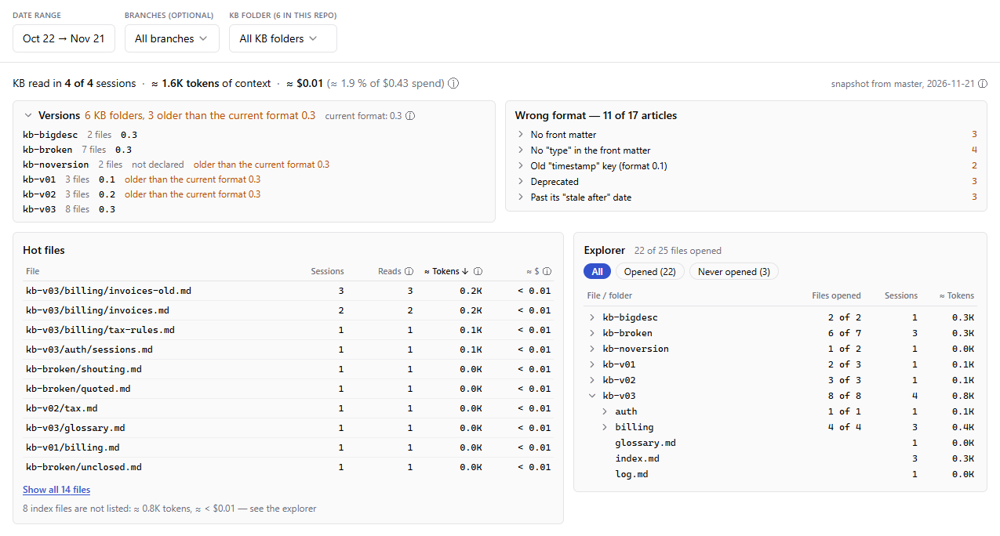

# OKF tab

An **OKF knowledge base** (KB) is a folder of Markdown articles for coding agents whose `index.md`
starts with an `okf_version:` front-matter line. The **OKF** tabs show how the agents of your
sessions used it: one summary line and four views.

- **Summary line** — how many sessions (or agents) read the KB, how much text that put into
  their context and roughly what it cost.
- **Versions** — which format version each KB folder declares.
- **Wrong format** — articles whose front matter is missing or out of date.
- **Hot files** — the articles read most.
- **Explorer** — every KB file, opened or never opened.

Everything is counted from the session transcripts and the list of KB files the hook sends with
each session. Nothing is judged by a language model.

There are two OKF tabs with the same layout. The repository tab counts **sessions** over a
period; the session tab counts the **agents** of one session.

## Repository OKF tab

Open a repository and pick **OKF** (between **Tools/MCP** and **OTEL**).

The **filter strip** on top sets the period, branches, users, attributes and the **KB folder**
(one or all). Every filter is kept in the page address, so a filtered view can be bookmarked or
shared. With one KB folder chosen, the views and the read numbers cover that folder only; the
session total and the spend stay those of the whole period.

Opened from **My Repos**, the tab shows your own sessions. Opened from a team, it shows the
sessions of the team members you may see; KB files that the author's git ignores never appear
there — not in a number and not in a path.

## Session OKF tab

The **OKF** tab of a session (under **Harness & context**, or **More ▾ → Effects**) covers the
session and all its sub-agents. It shows the same summary line and views; "Sessions" becomes
"Agents" everywhere, and "never opened" means never opened in this session.

## Summary line

> KB read in **233 of 306** sessions · **≈ 3.77M tokens** of context · **≈ $52.61** (≈ 1.7 % of
> $3,017 spend) · snapshot from `main`, 2026-11-20

- **N of M sessions** (session tab: **by N of M agents**) — M is every session of the period
  (every agent of the session); N is how many of them read at least one KB file.
- **≈ tokens of context** — the text the KB reads returned, as bytes ÷ 4. It is what the reads
  brought into the context, not the size of the files.
- **≈ $** and **% of spend** — see [The cost estimate](#the-cost-estimate).
- **snapshot from** *branch*, *date* — the list of KB files everything is measured against; see
  [The snapshot](#the-snapshot).

A **read** is a call that returned text of a KB file: opening the file (wholly or a line range,
also through `cat` or `sed` in the shell) or searching in it with grep. Listing a folder and
editing a file are not reads.

## Versions

One line while every KB folder is on the current format: "3 KB folders, all on format 0.3". Click
it to see each folder with its number of files and the version its `index.md` declares in
`okf_version:`.

A folder with an older version, or with no version, is marked **older than the current format
0.3** and the block opens by itself. To clear the mark, bring the folder's articles to the current
format and set `okf_version: "0.3"` in its `index.md`. The KB keeps working as it is — this is
advice.

A folder marked **not in git** is ignored by your git. You see it in your own view only; it never
appears in a team view.

## Wrong format

When every article is well-formed: "All 169 articles are well-formed · 6 index files are not
checked". Otherwise the block says "Wrong format — P of N articles" and lists the problems. Click a
problem to see its files.

| Problem | What it means | How to fix it |
|---|---|---|
| **No front matter** | The file does not start with a `---` block. | Add a front matter with at least `type:`, `title:` and `description:`. |
| **No "type" in the front matter** | There is a front matter, but no `type:` line. | Add `type:`. |
| **Old "timestamp" key (format 0.1)** | The front matter has `timestamp:` and no `generated:`. | Replace it with `generated: { by: "…", at: "…" }`. |
| **Deprecated** | The article says `status: deprecated`. "→ replaced by …" shows its `superseded_by:` article. | Delete the article and point its readers to the replacement, or remove the status when the article is valid again. |
| **Past its "stale after" date** | The article's `stale_after:` date has passed — today on the repository tab, the session start on the session tab — or is not a valid date. | Review the article, then move `stale_after:` forward or remove it. |

One article can be in several groups. The index files — `index.md` and `log.md`, in any folder —
are not articles and are not checked.

## Hot files

The articles that were read, heaviest first.

| Column | Meaning |
|---|---|
| **File** | The article's path in the repository. A long path is cut at the start; hover to see all of it. |
| **Sessions** / **Agents** | How many sessions (agents) read the file. |
| **Reads** | How many read and search calls returned text of the file. |
| **≈ Tokens** | The text those calls returned, bytes ÷ 4 — not the size of the file. |
| **≈ $** | The file's part of the KB cost. |

Click a column header to sort by it; click again to reverse. The table shows ten rows, then
**Show all N files**.

Index files are read by design, so they are not listed. One line under the table sums them:
"6 index files are not listed: ≈ 452K tokens, ≈ $6.57 — see the explorer".

What to look for: an article nearly every session reads may belong in always-loaded context
(`CLAUDE.md`); an article with many tokens per read may be worth splitting.

## Explorer

Every file of the KB as a folder tree. The header says "X of Y files opened"; three buttons choose
what to show:

- **All** — every file. Files nobody opened are grey with "—".
- **Opened (X)** — only files that were read.
- **Never opened (Y − X)** — only files nobody read in the period (in the session). Before you
  delete or merge such an article, widen the period: a 30-day window may simply not have needed
  it.

Each KB folder is a top row; click a row to open it. A folder row shows how many of its files were
opened, the sessions (agents) and the tokens. Two special rows:

- **searches across this folder** — searches that ran over the whole folder, not one file. They
  count in the summary line, but in no file's numbers.
- **Not in this snapshot** — files that were read but are not in the list of KB files shown:
  deleted, renamed, or on another branch.

A KB folder that sits inside another one is its own top row; its files are not counted in the
outer folder.

## The cost estimate

"≈ $" answers "what did carrying the KB in the context cost?". For each agent Log Hub takes the
share of the KB in everything the agent put into its context, and multiplies it by what that
context cost: input, cache write and cache read. Output tokens are not included. The estimate
assumes that KB text is carried along and re-read from the cache like the rest of the context.

**Spend** is the total cost of the same sessions with all their sub-agents, and the percentage is
the KB cost as a share of it. The file costs in **Hot files** add up to the summary.

When some agents have no computed cost, their reads are counted in tokens but not in dollars; the
ⓘ next to the cost says how many reads that is. "—" means no read has a cost.

It is an estimate — use it to compare files and periods, not as an invoice line.

## The snapshot

The hook sends the list of KB files with each session. The views are measured against one such
list:

- on the **repository tab**, the newest one taken on the `main` or `master` branch in the period;
  when there is none, the newest of all;
- on the **session tab**, the one sent with that session.

So "never opened" means "is in that list and nobody read it". A file you added on a feature branch
shows under **Not in this snapshot** until a session on the main branch has sent a new list.

## When the tab is one line

- **No KB snapshot — update the hook.** The session was recorded by a hook that does not send the
  list of KB files (older than 2.26), or the repository has no OKF knowledge base. **How to
  update** opens the install page. On the repository tab this line shows when no session of the
  period has a snapshot.
- **Update the hook to see versions and format problems.** This line replaces **Versions** and
  **Wrong format** when the snapshot comes from a hook older than 3.1.0, which does not send the
  front matter. The summary line, **Hot files** and the **Explorer** work as usual.

"No access" means your role in the team does not let you see this view.
