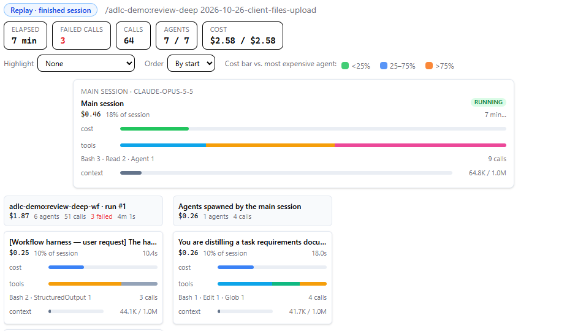
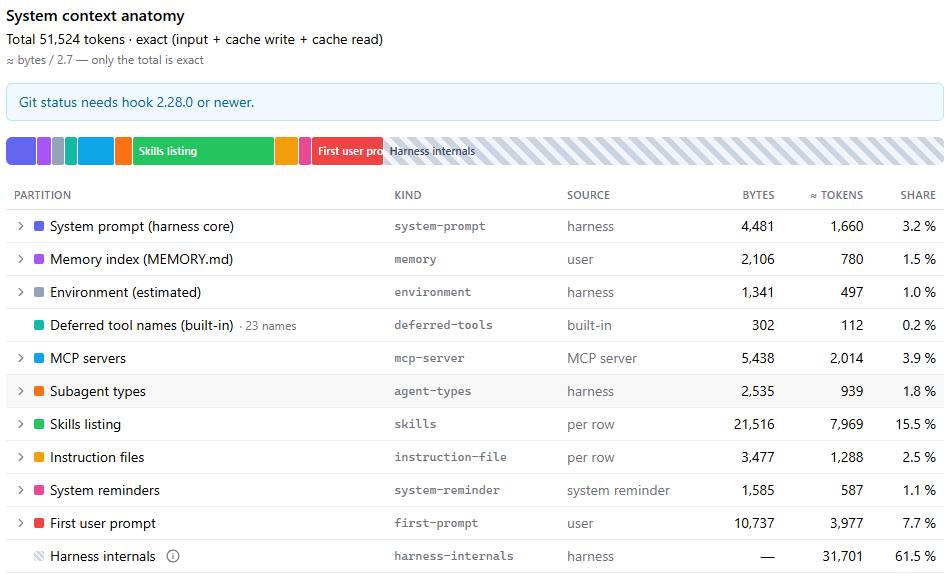

# Session Log

The Session Log view displays a complete record of a single Claude Code session. Open it by clicking any row in the repository's session list.

## Views and tabs

A session has one row of tabs. It starts with the **View** select, which picks the few tabs that
answer one question and shows them in the row:

| View | Tabs in the row | Opens on |
|---|---|---|
| What happened | Summary, Logs, Bash, Timeline, Agent Tree, Session Map, Change surface | Summary |
| Cost | Summary, Statistics, Call Tree, Context Growth, Dashboard, Advisor, OTEL | Statistics |
| Harness & context | System context anatomy, Context Usage, Harness usage, [OKF](okf-tab.md#session-okf-tab), Info | System context anatomy |
| Failed tool call | Tools/MCP, Logs, Bash, Tool Heatmap, OTEL | Tools/MCP |
| All tabs | every tab | Summary |

- **Cost** is the view you start with. Log Hub remembers the last view you picked, per user, in
  this browser.
- Switching the view opens the tab in the **Opens on** column. A session link without a tab
  always opens **Summary**, whatever the view.
- Tabs a view does not show are under **More ▾** at the end of the row, under the headings
  Overview, Transcript, Cost & context and Effects. The same menu takes the tabs that do not fit
  on a narrow screen.
- When you open a tab that is not in the view (from More, a Summary card or a link), it shows at
  the end of the row after a divider, so you always see which tab is open.
- Tabs that have nothing to show for this session are left out, for example Advisor without an
  advisor result. Raw Logs is shown to the session's owner and, in a team view, to whoever the
  server lets read the session's logs (any member of a transparent team; the team owner and ADLC
  trainers of a restricted one). The administrator role alone does not show it.
- The view is part of the page address (`&lens=harness`), so a copied link opens the same view.
  Choosing a tab never changes the view.

The headings in **More ▾** group the tabs like this:

| Heading | Tabs |
|---|---|
| Overview | Summary, Info, Statistics, Advisor, Session Map |
| Transcript | Logs, Bash, Raw Logs |
| Cost & context | Dashboard, Context Growth, Context Usage, Agent Tree, Timeline, Tool Heatmap, Call Tree, System context anatomy, Harness usage, OTEL |
| Effects | Change surface, Tools/MCP, [OKF](okf-tab.md#session-okf-tab) |

A red dot on **Tools/MCP** means an MCP server call of this session failed. Hover any tab for a
one-line description of what it shows.

The **Summary** tab ends with **Where to look next**: one card per tab worth a look, with its key
figure and **Open →**, and a row of questions (**Why so expensive?**, **What happened?**, **What
gets loaded?**, **Which tool failed?**) that switch to the matching view.

## Tabs

### Summary

The session at a glance: tiles for cost, peak context, turns, code impact, delegation, session
shape and change surface, the **Detected issues** findings (for example "Low cache reuse"),
**Extended details** with token, cache and sub-agent figures, and **Where to look next** (see
above).

### Info

Session metadata in collapsible sections, plus the token and cost table:

| Section | What it shows |
|---|---|
| Identity | Session UUID, repository, branch and user. |
| Timeline | Start, end, duration and autonomous work time. |
| Activity | Log records, prompts, sub-agents spawned, skills invoked and rules injected, with their context size. |
| Tokens & Cost | Tokens by kind and the cost of each, with the **"Calculated approx. total"** row. |
| Workflows | Each workflow run with its agents, tokens and cost (only when workflows ran). |
| Files & Tools | Reads and bytes per file category, edit/write calls, lines changed and log size. |
| MCP Usage | MCP calls by server (only when MCP servers were called). |
| Vision | Images examined (only when the session read images). |
| Productivity | Lines per autonomous hour, cost per autonomous hour and cost per line. |
| CLAUDE.md Context | Total bytes, estimated tokens and the instruction files loaded. |

### Statistics

Counters and tables for the whole session tree: **Productivity counters** (lines added and removed
from the edit diffs, commits, pull requests, turns), **Tool analytics** (calls, success rate,
failures and unresolved calls per tool), **Cache TTL and service tier**, and a **Per-API-call
iterations breakdown**. It is the tab the **Cost** view opens on.

### Advisor

Shown only when the hook's Turn-End Cost Advisor analysed the session: a **Summary**, the **Cost
factors** it found and **Harness advice**, with the cost and tokens of the analysis itself. The
lightbulb on a session row opens this tab.

### Logs

Shows each **prompt turn** in chronological order. The turn header carries the time, work time,
token chips, the **Cost** chip and the **Context** chip. Expand a turn to see the prompt, the
assistant's reply and the turn's sections: **Files**, **Skills**, **Rules**, **Tools**,
**Agents**, **Sub-agents** and **Workflows** (each only when it has entries).

Every tool call is listed once, in the section it belongs to: **Files** (Read, Edit, Write,
MultiEdit, Glob), **Skills**, **Agents** or **Tools** (everything else). Click a row in Files,
Skills, Agents or Tools to open the call's details: its input, its full output and, for Bash, the
readable command view described under [Bash](#bash). Agent calls that never started a sub-agent
(for example "Concurrent subagent limit reached") are listed under Agents as compact rows. A Tools
row starts with the call's own one-line description when the agent gave one (Bash and PowerShell
calls usually do), followed by the rest of its input in grey.

#### Call status

Each call shows how it ended:

| Badge | Meaning |
|---|---|
| ✓ ok | The call ran and returned a result. |
| ✗ error | The call ran and failed (for example "String to replace not found"). Files and Skills rows show a red ✗; hover it for the error. |
| ⊘ rejected | The call never ran: the user said no, or a permission rule or auto mode blocked it. Hover the badge for the reason. Files and Skills rows show an amber ⊘. |
| ⏸ interrupted | The user interrupted the call while it was running. |
| output not captured | The log has no result for this call (the session ended or was compacted first). |
| ⚠ requested / ⚠ denied | Claude Code asked for permission to run this call / the permission was denied. |

Rejected, interrupted and uncaptured calls are not counted as failures on the Statistics tab.

#### Sub-agents and workflow agents

The **Sub-agents** section shows the agents a turn started as a tree, nested agents under their
parent. A **Workflows** section lists each workflow run with its status, duration and a stats
strip (`N agents · M tokens · ~$cost · P tool uses`). Expand a run to see its args, summary,
findings and the **Agents (N)** table: one row per agent with `#`, Task, Duration, Tokens and
Cost, numbered `1`, `1.1`, … for nested agents. The table gains a **Phase** column when any agent
of the run has a workflow phase. Click a row to open that agent's session in a window with its own
**Logs** and **Raw logs** tabs.

A sub-agent is labelled by the description its parent gave it (sessions recorded with **hook
2.31.0 or newer** also carry the description and phase from the agent's own metadata), else by
the start of its task, else by its agent id. The same label is used in the Logs tab, the charts,
the Call Tree and the Session Map.

### Bash

Every Bash command of the session — the main session and all its sub-agents — in the order they
ran. The tab label shows how many there are.

- **Left list:** one row per command with its number, start time, duration, status, a "changes N"
  chip when the command changed files, and a preview (the command's description, else its first
  statement). Commands run by a sub-agent carry the sub-agent's badge. Use ↑ / ↓ to move through
  the list; the selected command is kept in the page URL, so the link opens the same command.
- **Right pane:** the selected command, top to bottom:
  - the description, with `timeout` / background chips;
  - **WORKING DIR** — the directory of a leading `cd`, shown relative to the repository;
  - **FILES** — what the command touched: Changes, Reads, Runs (`npm run build`, `git status`, …)
    and inline scripts (`node -e`, heredocs into an interpreter), which are only noted, never
    analysed. Long lists are grouped by folder. This is a best-effort reading of the command, not
    a record of what happened on disk;
  - **COMMAND** — the command laid out as a short script: one statement per line, loop and `if`
    bodies indented, long `&&` / `|` chains broken after the operator, long heredocs folded
    behind a "▸ block n" toggle, with line numbers and syntax colours. **Formatted | Raw**
    switches to the original layout, and **Copy original** copies the command exactly as Claude
    ran it;
  - **OUTPUT** — the command's output, scrollable, with its size and token estimate.
- "Open sub-agent →" opens the sub-agent's own log for a sub-agent's command.

Paths under the repository root are shown relative to it. Commands that cannot be parsed (and
PowerShell commands) are shown as plain text.

### Charts

Each chart is a tab of its own, all under **Cost & context** in **More ▾**. An older link that ends
in `tab=charts` opens the chart you looked at last (the dashboard the first time).

- **Dashboard** — Context Growth, Context Usage, Agent Tree, Timeline, Tool Heatmap and Call Tree
  as small cards on one screen; click a card to open its full tab.
- **Context Growth** — how the context window grew turn by turn. Expand a turn to see its steps;
  the number on the right of a step is how much the context grew until the next step (`+20k`,
  `−3k`, or `—` for the last step). Click a step row (or focus it and press Enter) to open its
  details: every tool call of the step with its status, input and output — the largest result
  first — followed by the assistant's text.
- **Context Usage** — what the context is made of at its peak: system overhead, file contents,
  tool results, images, prompt text and conversation history.
- **Agent Tree** — the main session and its sub-agents as a tree, workflow agents grouped under
  their workflow. Hover a node for its task, cost, duration and model; click it for its details.
- **Timeline** — a Gantt chart of when each agent worked, one lane per agent on one time axis.
  Hover a bar for its duration, cost, tool calls and model.
- **Tool Heatmap** — which tools were called when: one row per tool, one column per step, darker
  cells for more calls.
- **Call Tree** — where the session's tokens and cost went, as a tree: the system context and
  CLAUDE.md files, each prompt with its skills, files, output and cache, and each agent with a
  branch of its own. Every row shows its share of the cost, so the most expensive branch stands
  out.

### Harness usage

What harness the session used: a tree of the main session and every agent sub-session it spawned
(workflow fan-outs grouped under one node), and for the selected session a chronological list of
the skills, rules, sub-agent spawns, workflow runs, MCP tool calls and slash commands it used.
Turn on **Include sub-sessions** to fold in everything its descendants used as well. Ordinary
tool calls (Read, Bash, Edit…) are not listed here — the Logs and Statistics tabs cover those.

### Change surface

Where the session tree wrote: the changed files, folders and modules, the lines changed, and how
concentrated or spread out the changes were.

### Tools/MCP

The MCP server calls and monitored CLI tool calls of the session and all its sub-agents — the
repository's [Tools/MCP tab](session-list.md#toolsmcp-tab) narrowed to this one session. A red dot
on the tab means an MCP call of the session failed. The tree on the left groups calls by MCP / CLI,
tool and operation; the table lists each call with its status; click a call for its parameters,
input, output, stderr and signals. **Open in session ↗** opens the call's turn on the Logs tab.

### Session Map

In the **Overview** group, and in the **What happened** view after Agent Tree. It shows the whole
session as a map of cards — the main session, every workflow run and every agent — and lets you
watch it unfold over time, live or as a replay.

**Realtime and replay.** The badge at the top left says which mode you are in:

| Badge | Meaning |
|---|---|
| LIVE · following now | The session is running. The map checks for new activity every 10 seconds and shows the current moment. |
| LIVE · paused at HH:MM | The session is running, but you moved back in time. Click **Live** to follow it again. |
| LIVE · updates paused | The page is hidden or you have been idle; checking resumes when you come back. |
| Replay · finished session | The session has ended. Use **Play** or the timeline to move through it. |

A session counts as running only when its **OTEL data** is arriving (realtime OTEL or a recent
OTEL upload in the last 10 minutes; see the OTEL tab). Without OTEL the map still works, but always
as a replay: refresh the session to see new activity.

**Header.** The first prompt of the session and five counters for the chosen moment: elapsed time,
failed calls (red when there are any), calls, agents started out of all agents, and cost so far out
of the total.

**Controls.**

- **Highlight** — None, **Top 5 by cost**, or **Agents with failed calls**. Other cards are dimmed.
- **Order** — cards in each column **By start** or **By cost**.
- The colour legend next to them explains the cost bar on each card (green to red as an agent's
  cost approaches the most expensive agent).

**Cards.**

- The **main card** is the main session. Below it, one column per **workflow run**
  (`<workflow name> · run #N`), ordered by when it started, and a last column **Agents spawned by
  the main session**. An agent started by another agent is shown indented under it.
- Each agent card shows its name, cost bar, a strip of its tool calls by kind, its most used tools,
  a red **N failed** badge, its context use and its duration.
- A card for an agent that has not started yet at the chosen moment is faded with a dashed border;
  a running agent has a **running** label and a growing duration; a finished one looks normal.
- **No groups** means the session started no agents.

**Side panel.** Click a card to open a panel with its model, cost and share, calls, failed calls,
peak context (against the model's context window, `n/a` when unknown), duration and start time.
Below is its call log: filter it with the chips (**all**, each tool kind, **failed**), click a row
to move the map to that call's moment, or click **⤢** to open the call's full details. The selected
card is part of the page address, so a copied link opens it again.

**Timeline.** At the bottom, the session split into equal time slices. Each slice is coloured by
the kinds of tool calls in it — Read · Grep · Glob, Edit · Write, Bash · PowerShell, MCP,
Skill · Agent · Workflow and other — with a red mark for slices with failed calls, and a blue line
for the cost so far. Click or drag on it to move to a moment. Below it:

- **Play / Pause** and the speeds **1×, 10×, 60×, 300×** (60× by default);
- **End** jumps to the end of the session;
- **Live** (live sessions only) goes back to following the current moment.

The **refresh** button in the session header checks for new activity at once while this tab is open.

### Raw Logs

The unprocessed JSONL log lines captured by the hook. Useful for debugging hook issues or writing custom analysis.

### System context anatomy

In the **Cost & context** group. It shows what Claude Code sent to the model **before you typed anything** — the
startup context of the session's first request — and how big each part of it was. The top of the
Logs tab shows the same total in one line, "Startup context · N tokens", with a **View anatomy →**
link to this tab.

- **Total** — the exact size of the first request in tokens (input + cache write + cache read, as
  the model reported it).
- **The bar** — the total split into coloured parts: the system prompt, the memory index
  (MEMORY.md), environment details, built-in tool names, MCP servers, subagent types, the skills
  listing, instruction files (CLAUDE.md and friends), system reminders and your first prompt.
  Hover a part for its size and share; click it (or its table row) to select it.
- **The table** — the same parts with bytes, ≈ tokens and share. Expand a part to see what it is
  made of: one row per skill, per file, per MCP server (with its status, tool count and the tools
  it loaded later on demand) or per prompt line. Only names, paths and sizes are shown — never
  the text of a file or prompt.

Every part except the total is an **estimate**: its size in bytes divided by a bytes-per-token
ratio for the model (shown under the total). Only the total is exact.

**Harness internals** (the hatched part) is what is left: tokens Claude Code sent in the first
request but did not write to the session log, so they cannot be split further. It is mostly the
definitions of the built-in and MCP tools, message wrapping, and the combined error of the
estimates above. If the estimates add up to more than the measured total, a warning shows the
difference and there is no Harness internals part.

The skills and files tables show where each item lives and its **git status**:

| Git status | Meaning |
|---|---|
| tracked | The file is committed to the repository. |
| untracked | The file is inside the repository but not added to git. |
| ignored | The file is inside the repository and ignored by `.gitignore`. |
| outside repo | The file lives outside the repository — your home folder (`~/.claude/…`), a plugin or an organisation-synced skill. |
| unknown | Log Hub has no git status for this file. |

Git status and file sizes on disk come from the hook. Git status needs **hook 2.28.0 or newer**;
with an older hook the tab says so and shows `unknown` (or `outside repo` for files clearly outside
the repository). Sessions recorded with a hook older than 2.22.0 have no file sizes on disk either.
A skill synced to you by your organisation is shown with the source **org-synced**.
